# Agentic：吴恩达课程笔记

> [!summary]
> **agentic** 是程度不是开关。优势：效果 / 并行 / 模块化。落地先 SOP+文本。关键三技能：**拆步**、**Evals**、**四大设计模式**。Module 2 起深挖 **Reflection**：草稿→反思→改稿；有外部反馈（如跑代码报错）时显著更强。

来源：吴恩达 《Agentic AI》· P03–P09

---

# Module 1 总览

来源：P03–P08

> [!tip] 读图颜色（课内约定）
> 🔴 用户输入　⚪ LLM　🟢 工具/其它软件

---

## 1. 用 agentic，少争定义

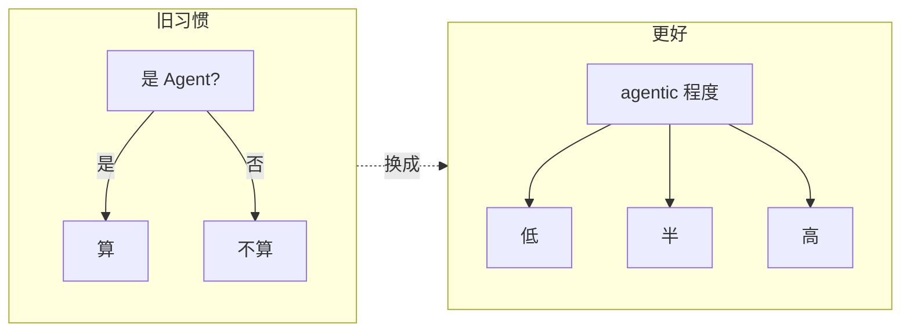

| 旧习惯 | 问题 | 更好做法 |
| --- | --- | --- |
| 二元：是 / 不是 Agent | 定义战 | 用 **agentic** 作形容词 |
| 争论「够不够自主」 | 耽误构建 | 承认程度不同，继续做 |

**自主性是连续谱，不是开关。**

---

## 2. 同一任务：低自主 vs 高自主

任务：写一篇关于黑洞的文章。**核心差别：谁决定下一步。**

### 低自主：工程师写死流水线

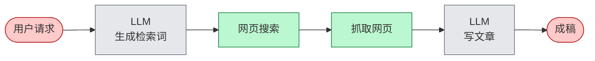

- 步骤 **确定性**（programmer 定死）
- 工具调用 **硬编码**
- LLM 主要负责 **生成文本**

### 高自主：LLM 当调度员


- 执行顺序可由 **LLM 决定**
- 工具选择、次数、是否回环都更动态

---

## 3. 自主性谱系

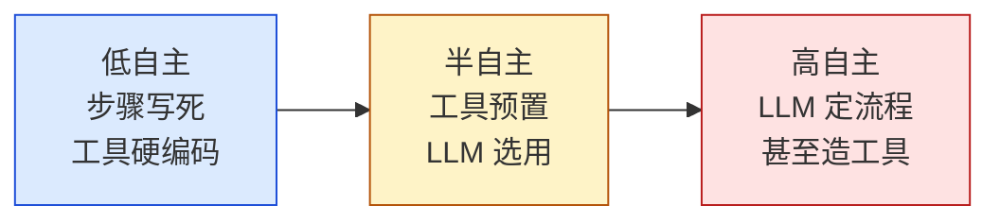

| 档位 | 谁定步骤 | 工具 | LLM 干什么 |
| --- | --- | --- | --- |
| **低** | 工程师预先定死 | 调用常硬编码 | 主要生成文本 |
| **半** | 部分决策交给 LLM | 工具预定义，LLM **选用** | 选工具、部分规划 |
| **高** | LLM 自定步骤序列 | 甚至可 **写新函数 / 造工具** | 规划 + 选工具 + 可能造工具 |

```text
要稳定、可预期  ←——————→  开放探索、可接受不可控
        偏左（企业大量落地）          偏右（更前沿）
```

> [!important]
> **不是越自主越好。** 先按可控性需求选位置。

---

## 4. 三大优势

最大卖点：许多 **以前做不好** 的任务变得可行。

### 4.1 效果：换工作流 > 换模型

HumanEval（写代码）课例示意（后两档为定性，非精确数字）：

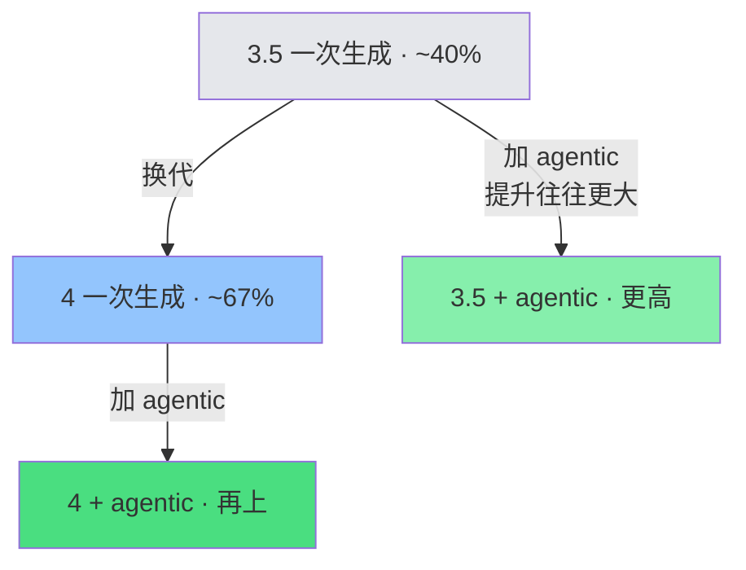

模型换代（3.5→4）已经很大，但把 **上一代** 包进 agentic，提升往往 **更大**。

→ **先设计工作流，别只等更强模型。**

### 4.2 并行：相对人类更快

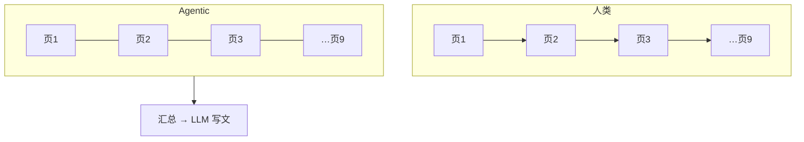

| 对比 | 结论 |
| --- | --- |
| vs 单次 prompt | Agentic **更慢**（多轮多步） |
| vs 人类串行研究 | 可并行抓取，**往往更快** |

### 4.3 模块化：拼最佳组件


习惯：盯 **单个组件** 做增删替换，整条链不要绑死一家。

---

## 5. 应用案例（由易到难）

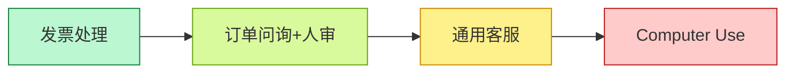

### 5.1 发票处理（易）

目标：开票方、地址、金额、到期日 → 写库按时付。

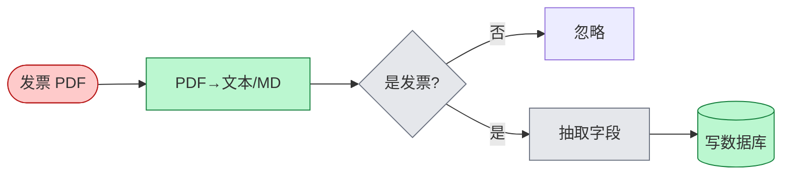

有明确 SOP → 易做成可靠逐步 workflow。

### 5.2 客户订单问询（稍难 · 人审）


步骤仍清晰；许多企业已在部署。

### 5.3 通用客服（更难 · 步骤未知）

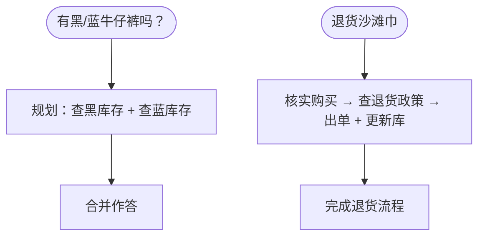

步骤 **不能预先写死**，要边走边规划 → 更难控。

### 5.4 Computer Use（很难 · 前沿）

课例：查 United 两班 SFO→DCA 是否有座。

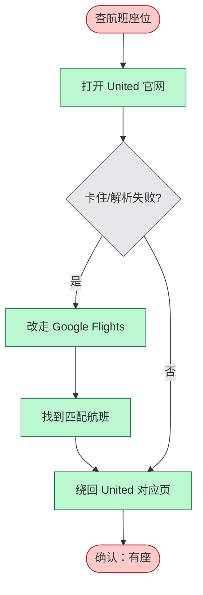

> [!warning]
> 页面慢加载会懵；很多页尚解析不准 → **暂不宜上关键路径**，但是重要方向。

---

## 6. 什么任务更好做

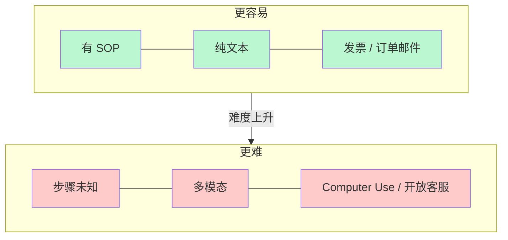

| 更容易 | 更难 |
| --- | --- |
| 已有 SOP，可逐步固化 | 步骤事先未知，边做边规划 |
| **纯文本**（LLM 所长） | 多模态（音/视）——能做但更脆 |
| 发票、订单邮件 | Computer Use、开放域客服 |

落地口诀：复杂流程 → **拆成可逐步执行的步骤** → 再做成 agentic workflow（见下节）。

---

## 7. 任务分解：识别工作流中的步骤

人和公司每天做很多有用的事。怎么拆成 **离散步骤**，让 agentic workflow 跟着走？

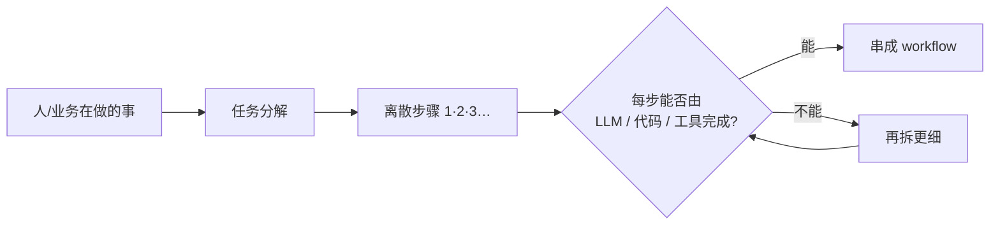

### 7.1 例：研究 Agent（迭代加细）

目标：就主题 X 写一篇有深度的文章。

**第 0 版：直接生成**


问题：往往只到表面、常识层，不够深。

**第 1 版：按「人会怎么写」拆三步**（大纲 → 搜网 → 再写）

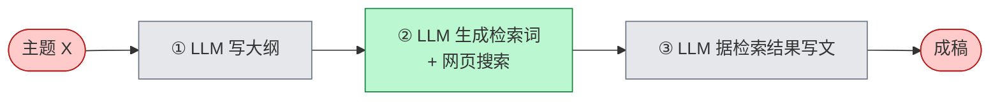

| 步骤 | 能否落地？ |
| --- | --- |
| 写大纲 | ✅ LLM 多数主题够用 |
| 检索 | ✅ LLM 出检索词 + 搜索工具 |
| 据结果写文 | ✅ LLM 吃检索结果再写 |

可作为 **合理的第一版 workflow**。

**第 2 版：成稿仍「散」→ 再拆「写文」**

开头 / 中间 / 结尾不一致时，人会：**初稿 → 审视哪里要改 → 修订**。


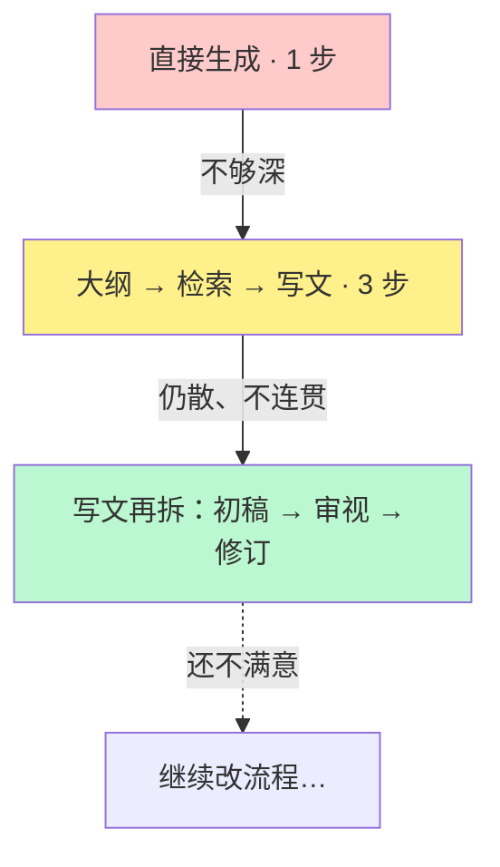

> [!important]
> 分解不是一次到位：先粗拆 → 跑起来看结果 → **对薄弱那一步继续拆**。

### 7.2 例：订单问询（拆步视角）

与 §5.2 同一业务，这里强调「每步能否落地」：


| 步骤 | 落地方式 |
| --- | --- |
| 抽信息 | LLM |
| 查记录 | LLM + **查订单库** |
| 回复 | LLM + **发邮件** API（或人审） |

### 7.3 例：发票（拆步视角）

与 §5.1 对应；PDF 已转文本后两步即可：


### 7.4 积木箱

建 workflow ≈ 用积木 **排顺序、接起来**。

```mermaid
mindmap
  root((积木))
    AI 模型
      LLM / 多模态
        生成文本
        决定调什么
        抽取信息
      专用模型
        PDF→文本
        TTS
        图像分析
    软件工具
      API
        实时搜索
        天气
        发邮件
        日历
      检索
        查数据库
        RAG
      执行代码
        LLM 写代码并在本机跑
```

```mermaid
flowchart LR
  Work[人/业务在做什么] --> Blocks[手头积木]
  Blocks --> Seq[怎样排序组合]
  Seq --> WF[agentic workflow]
```

越清楚积木有哪些，越容易想象能搭出什么。（工具细节后续模块展开。）

### 7.5 拆步心法（常问两句）

```mermaid
flowchart TB
  Step[看着某一步] --> Q1{LLM 或工具<br/>（API / 函数）能做吗?}
  Q1 -->|能| Keep[留下，接入 workflow]
  Q1 -->|不能| Q2[人会怎么做这一步?]
  Q2 --> Smaller[拆成更小步骤]
  Smaller --> Q1
```

| 问题 | 作用 |
| --- | --- |
| ① 这一步能否用 LLM 或工具实现？ | 判断是否「可落地」 |
| ② 若不能：人会怎么做？能否再拆细？ | 把不可行步变成可行微步 |

---

## 8. Evals：用评估驱动改进

能否高效做出好用的 agentic workflow，很大程度取决于有没有 **纪律性的评估（evals）**。本节约览；课程 Module 4 会深挖。

### 8.1 先建，再盯输出找坑

很难事先穷尽「会出什么错」。推荐：

```mermaid
flowchart LR
  Build[先做出 workflow] --> Read[人工读大量输出]
  Read --> Spot[发现「希望更好」的点]
  Spot --> Eval[加 eval 跟踪该错误]
  Eval --> Fix[改系统消掉问题]
  Fix --> Read
```

课例（订单客服）：读输出才发现常提竞品——

- *We're much better than CompCo*
- *Unlike RivalCo, we make returns easy*

业务上往往 **不想提竞品**；这类问题很难在建之前预见。

> [!important]
> **Best practice：先建 → 检查哪里不满意 → 再设计 eval + 改进**，而不是空想全套评估再动手。

### 8.2 客观指标：写代码数

若「提竞品」算错误，且有竞品名单（CompCo / RivalCo / OtherCo）：

- 在输出里 **字符串搜索** 竞品名
- 统计出现次数 / 占总回复比例

客观 = 黑白可判（提了 or 没提）→ **代码就能评**。

### 8.3 主观指标：LLM-as-Judge

自由文本还有难写死规则的标准（如「文章好不好」）。常用另一 LLM 当裁判：

```mermaid
flowchart LR
  Agent[研究 Agent 写多篇报告] --> Judge[Judge LLM<br/>按 1–5 打质量分]
  Judge --> Track[跟踪分数是否随改进上升]
```

例：黑洞进展文 → 3 分；机器人采水果文 → 4 分；改进 Agent 后期望分数上升。

> [!warning]
> LLM 对 **1–5 量表** 其实不太准；可作初切，吴恩达本人不太爱用。后续模块有更准的打分法。

### 8.4 两类 eval + 错误分析

| 类型 | 测什么 | 用途 |
| --- | --- | --- |
| **端到端（end-to-end）** | 整个 Agent 最终输出质量 | 看整体是否变好 |
| **组件级（component-level）** | 工作流 **某一步** 的输出质量 | 定位该改哪一环 |

另加 **Error analysis**：通读中间输出 / **traces**（每步 LLM 轨迹），找未达预期处 → 发现改进机会。

```mermaid
flowchart TB
  subgraph 评什么
    E2E[端到端 eval]
    Comp[组件级 eval]
  end
  subgraph 怎么评
    Obj[客观：代码检查]
    Sub[主观：LLM-as-Judge]
  end
  subgraph 怎么找坑
    Trace[读 traces / 中间输出]
  end
  E2E & Comp --> Obj & Sub
  Trace --> Spot2[改进点]
```

---

## 9. 四大设计模式

把积木拼成复杂 workflow 的常用 **拼法**：

```mermaid
flowchart LR
  R[① Reflection<br/>反思] --- T[② Tool Use<br/>工具使用]
  T --- P[③ Planning<br/>规划]
  P --- M[④ Multi-agent<br/>多 Agent 协作]
```

### 9.1 Reflection（反思）

让 LLM **审视自己的输出**（或结合外部反馈）再迭代：

```mermaid
flowchart LR
  U([写代码]) --> L1[LLM 生成代码]
  L1 --> L2[同一 LLM：仔细检查<br/>风格 / 效率 / 建设性质疑]
  L2 --> L3[据批评改代码]
  L3 --> O([更好版本])

  classDef user fill:#fecaca,stroke:#b91c1c
  classDef llm fill:#e5e7eb,stroke:#6b7280
  class U,O user
  class L1,L2,L3 llm
```

也可接入外部信号：跑代码看报错 → 喂回 LLM → 出 V3。  
**不是魔法**，不能保证 100%，但常能 **小幅抬性能**。

可演进为双 Agent：写码 Agent + **Critic Agent**（人设=挑错/跑单测）来回迭代（见 §9.4）。  
→ 展开见 **Module 2 §11–15**（P09）。

### 9.2 Tool Use（工具使用）

给 LLM **可调用的函数**，由其决定何时调用：

| 问法 | 工具 | 结果 |
| --- | --- | --- |
| 评测里最好的咖啡机？ | 网页搜索 | 比纯背训练数据准 |
| 100 美元复利算多少？ | 代码执行 | 写代码再跑出答案 |

工具覆盖：数学/数据分析、网页与数据库取数、邮件日历等生产力、图像处理……  
**决定调什么工具** = 能办更多事。

### 9.3 Planning（规划）

**由 LLM 决定步骤序列**（而非工程师写死），课例 HuggingGPT：

> 生成「女孩读书、姿势与图中男孩相同」的图，再用语音描述新图。

```mermaid
flowchart LR
  U([复杂请求]) --> Plan[LLM 规划步骤]
  Plan --> A1[姿态估计·男孩]
  A1 --> A2[按姿态生成女孩图]
  A2 --> A3[图→文]
  A3 --> A4[文→语音]
  A4 --> O([完成])

  classDef user fill:#fecaca,stroke:#b91c1c
  classDef llm fill:#e5e7eb,stroke:#6b7280
  classDef tool fill:#bbf7d0,stroke:#15803d
  class U,O user
  class Plan llm
  class A1,A2,A3,A4 tool
```

今日规划型 Agent：**更难控、偏实验**，但有时效果惊喜。

### 9.4 Multi-agent（多 Agent 协作）

像项目经理雇多人：多个 LLM，各带 **角色人设**，协作完成复杂任务。

**ChatDev**（陈芊等）：CEO / Programmer / Tester / Designer… 像虚拟软件公司一起做开发任务。

**营销手册** 也可拆三人组：

```mermaid
flowchart LR
  Task([写营销手册]) --> R[研究员<br/>上网调研]
  R --> M[营销写手<br/>写文案]
  M --> E[编辑<br/>润色]
  E --> O([成稿])

  classDef user fill:#fecaca,stroke:#b91c1c
  classDef llm fill:#e5e7eb,stroke:#6b7280
  class Task,O user
  class R,M,E llm
```

更难事先知道会怎么走 → **更难控**；研究显示在传记写作、棋步决策等复杂任务上可更好。课程后文会展开。

---

## 10. 带走（Module 1）

```mermaid
mindmap
  root((Agentic M1))
    程度不是开关
      低 / 半 / 高
    优势
      效果·并行·模块化
    落地
      SOP + 文本优先
    拆步
      LLM/工具能否做
      不能再按人拆
      积木排序
    Evals
      先建再找坑
      客观代码 / 主观 Judge
      端到端 + 组件级
      读 traces
    四大模式
      Reflection
      Tool Use
      Planning
      Multi-agent
    下一模块
      深挖 Reflection
```

---

# Module 2：反射设计模式（Reflection）

来源：P09 · 通过反射提升任务输出质量

> [!summary]
> Reflection = **生成初稿 →（同一或另一）LLM 反思并改稿**。实现简单、用途广。关键设计点：能塞进 **外部新信息**（跑代码输出/报错等）时，远比纯自省更强。不是魔法——常是 **小幅抬性能**，不能保 100%。

> [!tip] 读图颜色（同 Module 1）
> 🔴 用户输入　⚪ LLM　🟢 工具/其它软件

---

## 11. 核心想法：像人改稿一样

人写邮件常：打得快 → 初稿差 → 自己重读发现问题 → 改成更好版本。

课例（约汤米吃饭）：

| 初稿问题 | 改后 |
| --- | --- |
| 「下个月」时间含糊 | 具体到 5–7 号 |
| 笔误 | 修正 |
| 忘署名 | 补上 |

LLM 可走同一套：

```mermaid
flowchart LR
  U([任务]) --> L1[LLM · 写 Email v1]
  L1 --> L2[同一 LLM · 不同 prompt<br/>反思并改进]
  L2 --> O([Email v2])

  classDef user fill:#fecaca,stroke:#b91c1c
  classDef llm fill:#e5e7eb,stroke:#6b7280
  class U,O user
  class L1,L2 llm
```

- 工作流可 **硬编码**：先 prompt 一次生成，再 prompt 一次「反思并改进」
- 第二次可用 **同一模型**，换一套反思向的 prompt

> [!note]
> 课里把这一步叫 Reflection；和 Module 1 §9.1 是同一模式，这里展开实现与设计取舍。

---

## 12. 不止邮件：写代码同样适用

```mermaid
flowchart LR
  U([写某功能]) --> L1[LLM · Code v1]
  L1 --> L2[同一或另一 LLM<br/>查 bug → 写改进稿]
  L2 --> O([Code v2])

  classDef user fill:#fecaca,stroke:#b91c1c
  classDef llm fill:#e5e7eb,stroke:#6b7280
  class U,O user
  class L1,L2 llm
```

### 12.1 可按专长拆模型

不同 LM **强弱不同** → 初稿与反思可用不同模型。

| 阶段 | 常见选型 | 原因 |
| --- | --- | --- |
| 初稿 | 直接生成（普通 chat 模型） | 先快速出 v1 |
| 反思 / 查 bug | **推理模型**（reasoning / thinking models） | 找 bug 往往更强 |

```mermaid
flowchart LR
  U([写代码]) --> L1[普通模型 · 直接生成 v1]
  L1 --> L2[推理模型 · 查 bug / 改稿]
  L2 --> O([更好的 v2])

  classDef user fill:#fecaca,stroke:#b91c1c
  classDef llm fill:#e5e7eb,stroke:#6b7280
  class U,O user
  class L1,L2 llm
```

---

## 13. 关键设计点：外部反馈让反射更强

仅让 LLM「对着自己的输出反思」有用；若还能注入 **模型外部的新信息**，反射会 **强得多**。

写代码时最典型：

```mermaid
flowchart TB
  U([任务]) --> L1[LLM 生成 Code v1]
  L1 --> Run[🟢 执行代码]
  Run --> FB[输出 / 报错日志]
  FB --> L2[LLM：据反馈反思 → 写新稿]
  L2 --> O([Code v2 · 往往好很多])

  classDef user fill:#fecaca,stroke:#b91c1c
  classDef llm fill:#e5e7eb,stroke:#6b7280
  classDef tool fill:#bbf7d0,stroke:#15803d
  class U,O user
  class L1,L2 llm
  class Run,FB tool
```

课例：v1 一跑就是 **语法错误** → 把代码 + 错误日志喂回 → 再反思改稿 → v2 明显更好。

| 反射输入 | 力度 |
| --- | --- |
| 仅初稿 +「请改进」 | 有帮助 |
| 初稿 + **执行结果 / 报错** 等外部信息 | **深得多**，更容易定位问题 |

> [!important]
> **设计口诀：只要反射步骤有机会拿到额外外部信息，就尽量接进去。** 这是本模式最关键的设计考量。

---

## 14. 预期与边界

```mermaid
flowchart LR
  A[直接生成] -->|+ Reflection| B[常小幅提升]
  B -.->|有外部反馈| C[提升更明显]
  C -.->|仍非| D[100% 正确]
  style A fill:#e5e7eb
  style B fill:#fef08a
  style C fill:#bbf7d0
  style D fill:#fecaca
```

| 说法 | 课里态度 |
| --- | --- |
| Reflection 是魔法？ | ❌ 不是 |
| 能否永远做对？ | ❌ 不能保证 100% |
| 实际价值 | 常给 **modest bump**（适度抬升） |
| 何时特别值得 | 能注入外部反馈时 |

下一讲预告：系统对比 **Reflection vs 直接生成（zero-shot prompting）**。

---

## 15. 带走（Module 2 · 本讲）

```mermaid
mindmap
  root((Reflection P09))
    流程
      初稿 v1
      反思 prompt
      改进稿 v2
    实现
      可硬编码两步
      同模或异模
      推理模擅查 bug
    外部反馈
      跑代码 / 看报错
      新信息 → 反射更强
    预期
      小幅抬性能
      非 100%
```
