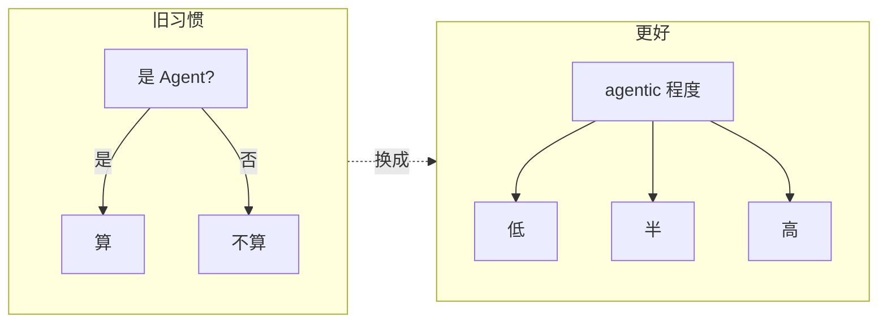
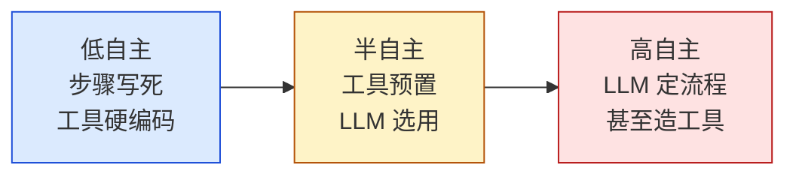
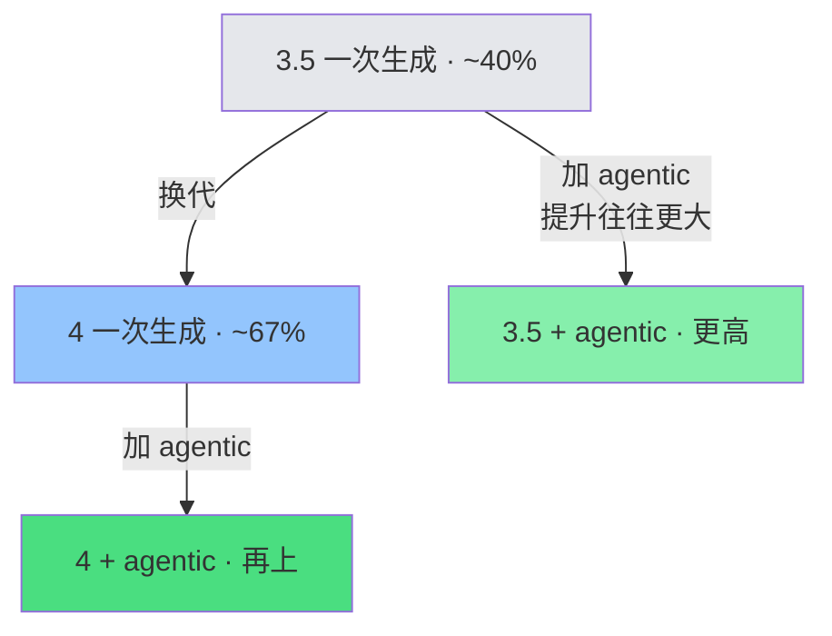
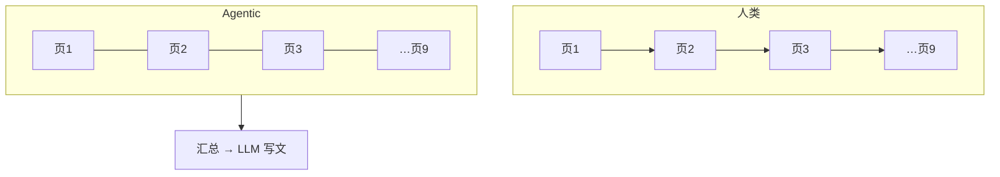
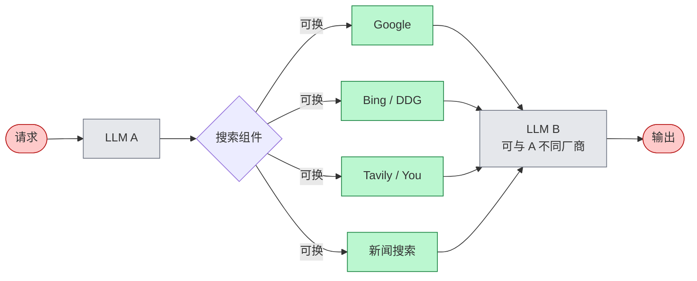
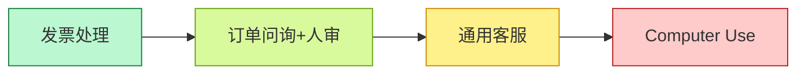
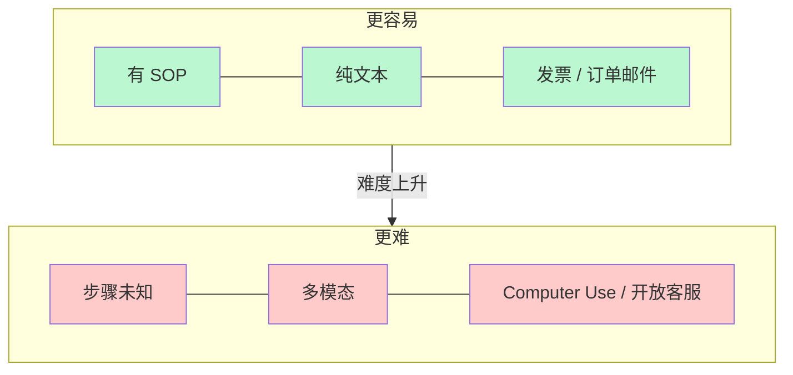
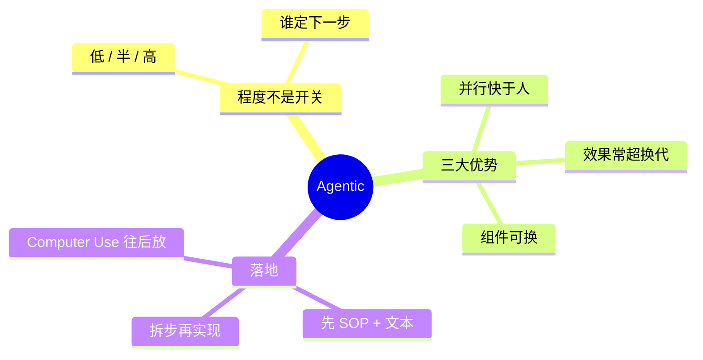

# Agentic：自主性、优势与应用

> [!summary]
> **agentic** 描述程度，不争论「算不算 Agent」。自主性：低 → 半 → 高。三大优势：效果、并行、模块化。落地从 **有 SOP、偏文本** 起步；步骤未知 / Computer Use 更难。核心技能：**任务拆步**。

来源：吴恩达 《Agentic AI》· P03–P05

> [!tip] 读图颜色（课内约定）
> 🔴 用户输入　⚪ LLM　🟢 工具/其它软件

---

## 1. 用 agentic，少争定义



| 旧习惯 | 问题 | 更好做法 |
| --- | --- | --- |
| 二元：是 / 不是 Agent | 定义战 | 用 **agentic** 作形容词 |
| 争论「够不够自主」 | 耽误构建 | 承认程度不同，继续做 |

**自主性是连续谱，不是开关。**

---

## 2. 同一任务：低自主 vs 高自主

任务：写一篇关于黑洞的文章。**核心差别：谁决定下一步。**

### 低自主：工程师写死流水线


- 步骤 **确定性**（programmer 定死）
- 工具调用 **硬编码**
- LLM 主要负责 **生成文本**

### 高自主：LLM 当调度员


- 执行顺序可由 **LLM 决定**
- 工具选择、次数、是否回环都更动态

---

## 3. 自主性谱系



| 档位 | 谁定步骤 | 工具 | LLM 干什么 |
| --- | --- | --- | --- |
| **低** | 工程师预先定死 | 调用常硬编码 | 主要生成文本 |
| **半** | 部分决策交给 LLM | 工具预定义，LLM **选用** | 选工具、部分规划 |
| **高** | LLM 自定步骤序列 | 甚至可 **写新函数 / 造工具** | 规划 + 选工具 + 可能造工具 |

```text
要稳定、可预期  ←——————→  开放探索、可接受不可控
        偏左（企业大量落地）          偏右（更前沿）
```

> [!important]
> **不是越自主越好。** 先按可控性需求选位置。

---

## 4. 三大优势

最大卖点：许多 **以前做不好** 的任务变得可行。

### 4.1 效果：换工作流 > 换模型

HumanEval（写代码）课例示意（后两档为定性，非精确数字）：



模型换代（3.5→4）已经很大，但把 **上一代** 包进 agentic，提升往往 **更大**。

→ **先设计工作流，别只等更强模型。**

### 4.2 并行：相对人类更快



| 对比 | 结论 |
| --- | --- |
| vs 单次 prompt | Agentic **更慢**（多轮多步） |
| vs 人类串行研究 | 可并行抓取，**往往更快** |

### 4.3 模块化：拼最佳组件



习惯：盯 **单个组件** 做增删替换，整条链不要绑死一家。

---

## 5. 应用案例（由易到难）



### 5.1 发票处理（易）

目标：开票方、地址、金额、到期日 → 写库按时付。


有明确 SOP → 易做成可靠逐步 workflow。

### 5.2 客户订单问询（稍难 · 人审）


步骤仍清晰；许多企业已在部署。

### 5.3 通用客服（更难 · 步骤未知）


步骤 **不能预先写死**，要边走边规划 → 更难控。

### 5.4 Computer Use（很难 · 前沿）

课例：查 United 两班 SFO→DCA 是否有座。


> [!warning]
> 页面慢加载会懵；很多页尚解析不准 → **暂不宜上关键路径**，但是重要方向。

---

## 6. 什么任务更好做



| 更容易 | 更难 |
| --- | --- |
| 已有 SOP，可逐步固化 | 步骤事先未知，边做边规划 |
| **纯文本**（LLM 所长） | 多模态（音/视）——能做但更脆 |
| 发票、订单邮件 | Computer Use、开放域客服 |

落地口诀：复杂流程 → **拆成可逐步执行的步骤** → 再做成 agentic workflow。  
下一讲：**任务分解（task decomposition）**。

---

## 7. 带走


