# Agentic：吴恩达课程笔记

> [!summary]
> **agentic** 是程度不是开关。落地先 SOP+文本。关键：**拆步**、**Evals**、四大模式。M2 Reflection（外部反馈 ≫ 自省）。M3 **Tool Use**：工具=可请求调用的**函数**；由 LLM **决定是否/何时**调用（非工程师硬编码）。

来源：吴恩达 《Agentic AI》· P03–P14

---

# Module 1 总览

来源：P03–P08

> [!tip] 读图颜色（课内约定）
> 🔴 用户输入　⚪ LLM　🟢 工具/其它软件

---

## 1. 用 agentic，少争定义

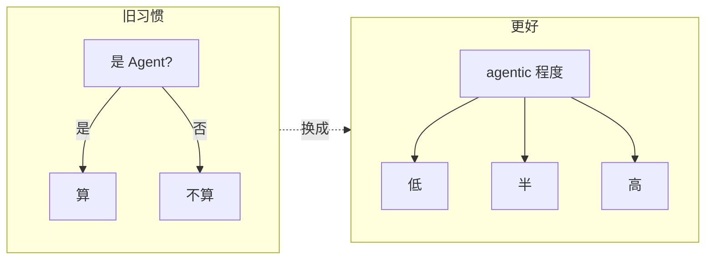

| 旧习惯 | 问题 | 更好做法 |
| --- | --- | --- |
| 二元：是 / 不是 Agent | 定义战 | 用 **agentic** 作形容词 |
| 争论「够不够自主」 | 耽误构建 | 承认程度不同，继续做 |

**自主性是连续谱，不是开关。**

---

## 2. 同一任务：低自主 vs 高自主

任务：写一篇关于黑洞的文章。**核心差别：谁决定下一步。**

### 低自主：工程师写死流水线


- 步骤 **确定性**（programmer 定死）
- 工具调用 **硬编码**
- LLM 主要负责 **生成文本**

### 高自主：LLM 当调度员

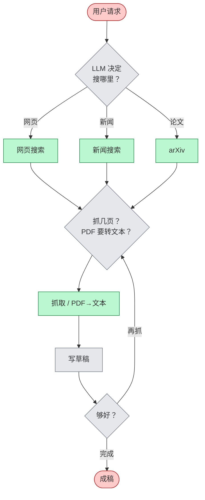

- 执行顺序可由 **LLM 决定**
- 工具选择、次数、是否回环都更动态

---

## 3. 自主性谱系

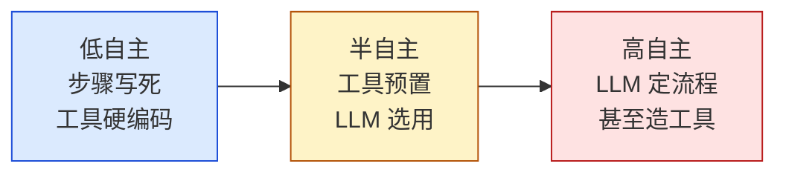

| 档位 | 谁定步骤 | 工具 | LLM 干什么 |
| --- | --- | --- | --- |
| **低** | 工程师预先定死 | 调用常硬编码 | 主要生成文本 |
| **半** | 部分决策交给 LLM | 工具预定义，LLM **选用** | 选工具、部分规划 |
| **高** | LLM 自定步骤序列 | 甚至可 **写新函数 / 造工具** | 规划 + 选工具 + 可能造工具 |

```text
要稳定、可预期  ←——————→  开放探索、可接受不可控
        偏左（企业大量落地）          偏右（更前沿）
```

> [!important]
> **不是越自主越好。** 先按可控性需求选位置。

---

## 4. 三大优势

最大卖点：许多 **以前做不好** 的任务变得可行。

### 4.1 效果：换工作流 > 换模型

HumanEval（写代码）课例示意（后两档为定性，非精确数字）：

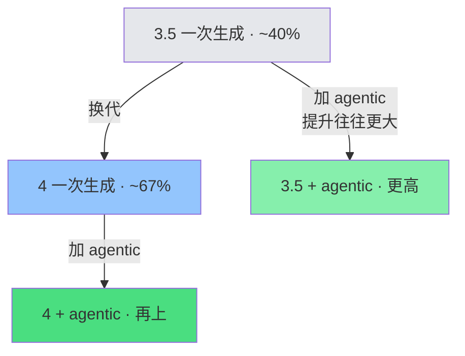

模型换代（3.5→4）已经很大，但把 **上一代** 包进 agentic，提升往往 **更大**。

→ **先设计工作流，别只等更强模型。**

### 4.2 并行：相对人类更快

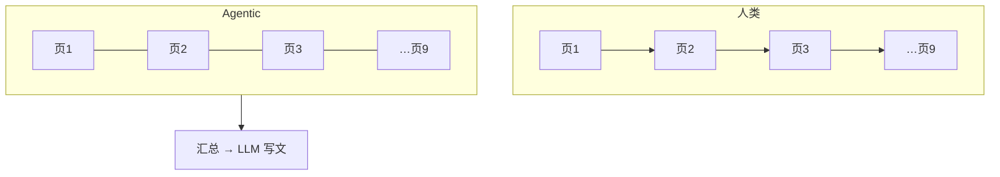

| 对比 | 结论 |
| --- | --- |
| vs 单次 prompt | Agentic **更慢**（多轮多步） |
| vs 人类串行研究 | 可并行抓取，**往往更快** |

### 4.3 模块化：拼最佳组件


习惯：盯 **单个组件** 做增删替换，整条链不要绑死一家。

---

## 5. 应用案例（由易到难）

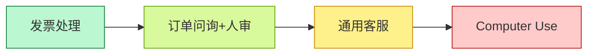

### 5.1 发票处理（易）

目标：开票方、地址、金额、到期日 → 写库按时付。


有明确 SOP → 易做成可靠逐步 workflow。

### 5.2 客户订单问询（稍难 · 人审）

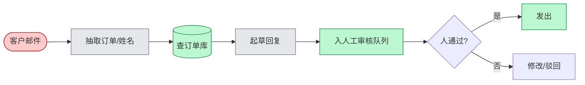

步骤仍清晰；许多企业已在部署。

### 5.3 通用客服（更难 · 步骤未知）


步骤 **不能预先写死**，要边走边规划 → 更难控。

### 5.4 Computer Use（很难 · 前沿）

课例：查 United 两班 SFO→DCA 是否有座。


> [!warning]
> 页面慢加载会懵；很多页尚解析不准 → **暂不宜上关键路径**，但是重要方向。

---

## 6. 什么任务更好做

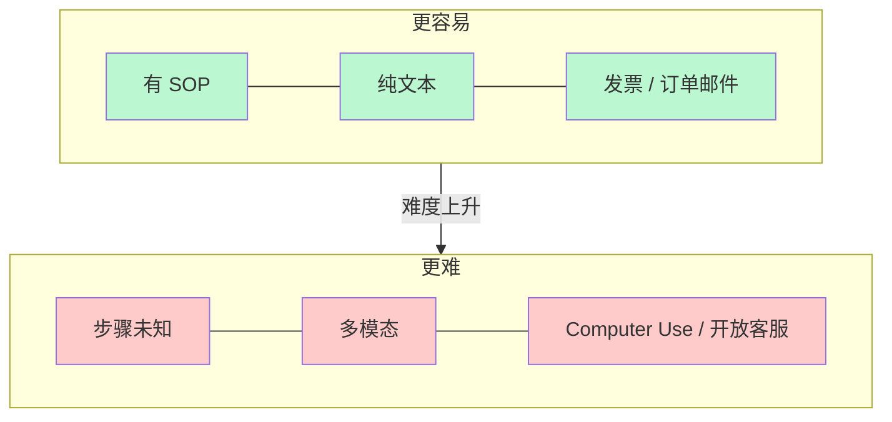

| 更容易 | 更难 |
| --- | --- |
| 已有 SOP，可逐步固化 | 步骤事先未知，边做边规划 |
| **纯文本**（LLM 所长） | 多模态（音/视）——能做但更脆 |
| 发票、订单邮件 | Computer Use、开放域客服 |

落地口诀：复杂流程 → **拆成可逐步执行的步骤** → 再做成 agentic workflow（见下节）。

---

## 7. 任务分解：识别工作流中的步骤

人和公司每天做很多有用的事。怎么拆成 **离散步骤**，让 agentic workflow 跟着走？

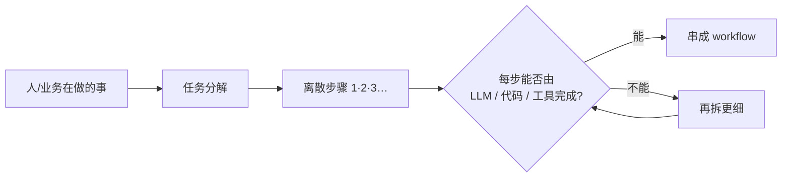

### 7.1 例：研究 Agent（迭代加细）

目标：就主题 X 写一篇有深度的文章。

**第 0 版：直接生成**


问题：往往只到表面、常识层，不够深。

**第 1 版：按「人会怎么写」拆三步**（大纲 → 搜网 → 再写）


| 步骤 | 能否落地？ |
| --- | --- |
| 写大纲 | ✅ LLM 多数主题够用 |
| 检索 | ✅ LLM 出检索词 + 搜索工具 |
| 据结果写文 | ✅ LLM 吃检索结果再写 |

可作为 **合理的第一版 workflow**。

**第 2 版：成稿仍「散」→ 再拆「写文」**

开头 / 中间 / 结尾不一致时，人会：**初稿 → 审视哪里要改 → 修订**。


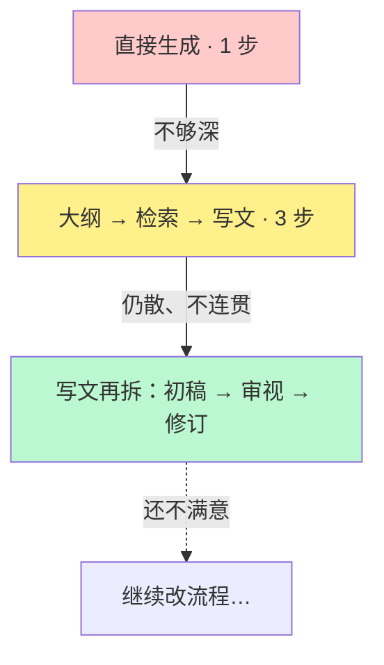

> [!important]
> 分解不是一次到位：先粗拆 → 跑起来看结果 → **对薄弱那一步继续拆**。

### 7.2 例：订单问询（拆步视角）

与 §5.2 同一业务，这里强调「每步能否落地」：


| 步骤 | 落地方式 |
| --- | --- |
| 抽信息 | LLM |
| 查记录 | LLM + **查订单库** |
| 回复 | LLM + **发邮件** API（或人审） |

### 7.3 例：发票（拆步视角）

与 §5.1 对应；PDF 已转文本后两步即可：

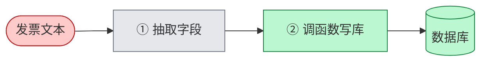

### 7.4 积木箱

建 workflow ≈ 用积木 **排顺序、接起来**。

```mermaid
mindmap
  root((积木))
    AI 模型
      LLM / 多模态
        生成文本
        决定调什么
        抽取信息
      专用模型
        PDF→文本
        TTS
        图像分析
    软件工具
      API
        实时搜索
        天气
        发邮件
        日历
      检索
        查数据库
        RAG
      执行代码
        LLM 写代码并在本机跑
```

```mermaid
flowchart LR
  Work[人/业务在做什么] --> Blocks[手头积木]
  Blocks --> Seq[怎样排序组合]
  Seq --> WF[agentic workflow]
```

越清楚积木有哪些，越容易想象能搭出什么。（工具细节后续模块展开。）

### 7.5 拆步心法（常问两句）

```mermaid
flowchart TB
  Step[看着某一步] --> Q1{LLM 或工具<br/>（API / 函数）能做吗?}
  Q1 -->|能| Keep[留下，接入 workflow]
  Q1 -->|不能| Q2[人会怎么做这一步?]
  Q2 --> Smaller[拆成更小步骤]
  Smaller --> Q1
```

| 问题 | 作用 |
| --- | --- |
| ① 这一步能否用 LLM 或工具实现？ | 判断是否「可落地」 |
| ② 若不能：人会怎么做？能否再拆细？ | 把不可行步变成可行微步 |

---

## 8. Evals：用评估驱动改进

能否高效做出好用的 agentic workflow，很大程度取决于有没有 **纪律性的评估（evals）**。本节约览；课程 Module 4 会深挖。

### 8.1 先建，再盯输出找坑

很难事先穷尽「会出什么错」。推荐：

```mermaid
flowchart LR
  Build[先做出 workflow] --> Read[人工读大量输出]
  Read --> Spot[发现「希望更好」的点]
  Spot --> Eval[加 eval 跟踪该错误]
  Eval --> Fix[改系统消掉问题]
  Fix --> Read
```

课例（订单客服）：读输出才发现常提竞品——

- *We're much better than CompCo*
- *Unlike RivalCo, we make returns easy*

业务上往往 **不想提竞品**；这类问题很难在建之前预见。

> [!important]
> **Best practice：先建 → 检查哪里不满意 → 再设计 eval + 改进**，而不是空想全套评估再动手。

### 8.2 客观指标：写代码数

若「提竞品」算错误，且有竞品名单（CompCo / RivalCo / OtherCo）：

- 在输出里 **字符串搜索** 竞品名
- 统计出现次数 / 占总回复比例

客观 = 黑白可判（提了 or 没提）→ **代码就能评**。

### 8.3 主观指标：LLM-as-Judge

自由文本还有难写死规则的标准（如「文章好不好」）。常用另一 LLM 当裁判：

```mermaid
flowchart LR
  Agent[研究 Agent 写多篇报告] --> Judge[Judge LLM<br/>按 1–5 打质量分]
  Judge --> Track[跟踪分数是否随改进上升]
```

例：黑洞进展文 → 3 分；机器人采水果文 → 4 分；改进 Agent 后期望分数上升。

> [!warning]
> LLM 对 **1–5 量表** 其实不太准；可作初切，吴恩达本人不太爱用。更稳做法见 **§17.2**：rubric + 多个 0/1 标准求和（并避免两两比较的位置偏差）。

### 8.4 两类 eval + 错误分析

| 类型 | 测什么 | 用途 |
| --- | --- | --- |
| **端到端（end-to-end）** | 整个 Agent 最终输出质量 | 看整体是否变好 |
| **组件级（component-level）** | 工作流 **某一步** 的输出质量 | 定位该改哪一环 |

另加 **Error analysis**：通读中间输出 / **traces**（每步 LLM 轨迹），找未达预期处 → 发现改进机会。

```mermaid
flowchart TB
  subgraph 评什么
    E2E[端到端 eval]
    Comp[组件级 eval]
  end
  subgraph 怎么评
    Obj[客观：代码检查]
    Sub[主观：LLM-as-Judge]
  end
  subgraph 怎么找坑
    Trace[读 traces / 中间输出]
  end
  E2E & Comp --> Obj & Sub
  Trace --> Spot2[改进点]
```

---

## 9. 四大设计模式

把积木拼成复杂 workflow 的常用 **拼法**：

```mermaid
flowchart LR
  R[① Reflection<br/>反思] --- T[② Tool Use<br/>工具使用]
  T --- P[③ Planning<br/>规划]
  P --- M[④ Multi-agent<br/>多 Agent 协作]
```

### 9.1 Reflection（反思）

让 LLM **审视自己的输出**（或结合外部反馈）再迭代：

```mermaid
flowchart LR
  U([写代码]) --> L1[LLM 生成代码]
  L1 --> L2[同一 LLM：仔细检查<br/>风格 / 效率 / 建设性质疑]
  L2 --> L3[据批评改代码]
  L3 --> O([更好版本])

  classDef user fill:#fecaca,stroke:#b91c1c
  classDef llm fill:#e5e7eb,stroke:#6b7280
  class U,O user
  class L1,L2,L3 llm
```

也可接入外部信号：跑代码看报错 → 喂回 LLM → 出 V3。  
**不是魔法**，不能保证 100%，但常能 **小幅抬性能**。

可演进为双 Agent：写码 Agent + **Critic Agent**（人设=挑错/跑单测）来回迭代（见 §9.4）。  
→ 展开见 **Module 2 §11–15**（P09）。

### 9.2 Tool Use（工具使用）

给 LLM **可调用的函数**，由其决定何时调用：

| 问法 | 工具 | 结果 |
| --- | --- | --- |
| 评测里最好的咖啡机？ | 网页搜索 | 比纯背训练数据准 |
| 100 美元复利算多少？ | 代码执行 | 写代码再跑出答案 |

工具覆盖：数学/数据分析、网页与数据库取数、邮件日历等生产力、图像处理……  
**决定调什么工具** = 能办更多事。→ 展开见 **Module 3 §21+**（P14）。

### 9.3 Planning（规划）

**由 LLM 决定步骤序列**（而非工程师写死），课例 HuggingGPT：

> 生成「女孩读书、姿势与图中男孩相同」的图，再用语音描述新图。

```mermaid
flowchart LR
  U([复杂请求]) --> Plan[LLM 规划步骤]
  Plan --> A1[姿态估计·男孩]
  A1 --> A2[按姿态生成女孩图]
  A2 --> A3[图→文]
  A3 --> A4[文→语音]
  A4 --> O([完成])

  classDef user fill:#fecaca,stroke:#b91c1c
  classDef llm fill:#e5e7eb,stroke:#6b7280
  classDef tool fill:#bbf7d0,stroke:#15803d
  class U,O user
  class Plan llm
  class A1,A2,A3,A4 tool
```

今日规划型 Agent：**更难控、偏实验**，但有时效果惊喜。

### 9.4 Multi-agent（多 Agent 协作）

像项目经理雇多人：多个 LLM，各带 **角色人设**，协作完成复杂任务。

**ChatDev**（陈芊等）：CEO / Programmer / Tester / Designer… 像虚拟软件公司一起做开发任务。

**营销手册** 也可拆三人组：

```mermaid
flowchart LR
  Task([写营销手册]) --> R[研究员<br/>上网调研]
  R --> M[营销写手<br/>写文案]
  M --> E[编辑<br/>润色]
  E --> O([成稿])

  classDef user fill:#fecaca,stroke:#b91c1c
  classDef llm fill:#e5e7eb,stroke:#6b7280
  class Task,O user
  class R,M,E llm
```

更难事先知道会怎么走 → **更难控**；研究显示在传记写作、棋步决策等复杂任务上可更好。课程后文会展开。

---

## 10. 带走（Module 1）

```mermaid
mindmap
  root((Agentic M1))
    程度不是开关
      低 / 半 / 高
    优势
      效果·并行·模块化
    落地
      SOP + 文本优先
    拆步
      LLM/工具能否做
      不能再按人拆
      积木排序
    Evals
      先建再找坑
      客观代码 / 主观 Judge
      端到端 + 组件级
      读 traces
    四大模式
      Reflection
      Tool Use
      Planning
      Multi-agent
    下一模块
      深挖 Reflection
```

---

# Module 2：反射设计模式（Reflection）

来源：P09–P13

> [!summary]
> Reflection = **初稿 → 反思改稿**。**有外部新信息 ≫ 仅 LLM 自省**。prompt 调到收益递减时，尽早加反射，更好再加外部反馈（执行/检索/计数等工具）。用 evals 量化；Module 2 收束，下一模块 Tool Use。

> [!tip] 读图颜色（同 Module 1）
> 🔴 用户输入　⚪ LLM　🟢 工具/其它软件

---

## 11. 核心想法：像人改稿一样

人写邮件常：打得快 → 初稿差 → 自己重读发现问题 → 改成更好版本。

课例（约汤米吃饭）：

| 初稿问题 | 改后 |
| --- | --- |
| 「下个月」时间含糊 | 具体到 5–7 号 |
| 笔误 | 修正 |
| 忘署名 | 补上 |

LLM 可走同一套：

```mermaid
flowchart LR
  U([任务]) --> L1[LLM · 写 Email v1]
  L1 --> L2[同一 LLM · 不同 prompt<br/>反思并改进]
  L2 --> O([Email v2])

  classDef user fill:#fecaca,stroke:#b91c1c
  classDef llm fill:#e5e7eb,stroke:#6b7280
  class U,O user
  class L1,L2 llm
```

- 工作流可 **硬编码**：先 prompt 一次生成，再 prompt 一次「反思并改进」
- 第二次可用 **同一模型**，换一套反思向的 prompt

> [!note]
> 课里把这一步叫 Reflection；和 Module 1 §9.1 是同一模式，这里展开实现与设计取舍。

---

## 12. 不止邮件：写代码同样适用

```mermaid
flowchart LR
  U([写某功能]) --> L1[LLM · Code v1]
  L1 --> L2[同一或另一 LLM<br/>查 bug → 写改进稿]
  L2 --> O([Code v2])

  classDef user fill:#fecaca,stroke:#b91c1c
  classDef llm fill:#e5e7eb,stroke:#6b7280
  class U,O user
  class L1,L2 llm
```

### 12.1 可按专长拆模型

不同 LM **强弱不同** → 初稿与反思可用不同模型。

| 阶段 | 常见选型 | 原因 |
| --- | --- | --- |
| 初稿 | 直接生成（普通 chat 模型） | 先快速出 v1 |
| 反思 / 查 bug | **推理模型**（reasoning / thinking models） | 找 bug 往往更强 |

```mermaid
flowchart LR
  U([写代码]) --> L1[普通模型 · 直接生成 v1]
  L1 --> L2[推理模型 · 查 bug / 改稿]
  L2 --> O([更好的 v2])

  classDef user fill:#fecaca,stroke:#b91c1c
  classDef llm fill:#e5e7eb,stroke:#6b7280
  class U,O user
  class L1,L2 llm
```

---

## 13. 关键设计点：外部反馈让反射更强

仅让 LLM「对着自己的输出反思」有用；若还能注入 **模型外部的新信息**，反射会 **强得多**。

写代码时最典型：

```mermaid
flowchart TB
  U([任务]) --> L1[LLM 生成 Code v1]
  L1 --> Run[🟢 执行代码]
  Run --> FB[输出 / 报错日志]
  FB --> L2[LLM：据反馈反思 → 写新稿]
  L2 --> O([Code v2 · 往往好很多])

  classDef user fill:#fecaca,stroke:#b91c1c
  classDef llm fill:#e5e7eb,stroke:#6b7280
  classDef tool fill:#bbf7d0,stroke:#15803d
  class U,O user
  class L1,L2 llm
  class Run,FB tool
```

课例：v1 一跑就是 **语法错误** → 把代码 + 错误日志喂回 → 再反思改稿 → v2 明显更好。

| 反射输入 | 力度 |
| --- | --- |
| 仅初稿 +「请改进」 | 有帮助 |
| 初稿 + **执行结果 / 报错** 等外部信息 | **深得多**，更容易定位问题 |

> [!important]
> **设计口诀：只要反射步骤有机会拿到额外外部信息，就尽量接进去。** 这是本模式最关键的设计考量。展开与更多工具例见 **§19（P13）**。

---

## 14. 预期与边界

```mermaid
flowchart LR
  A[直接生成] -->|+ Reflection| B[常小幅提升]
  B -.->|有外部反馈| C[提升更明显]
  C -.->|仍非| D[100% 正确]
  style A fill:#e5e7eb
  style B fill:#fef08a
  style C fill:#bbf7d0
  style D fill:#fecaca
```

| 说法 | 课里态度 |
| --- | --- |
| Reflection 是魔法？ | ❌ 不是 |
| 能否永远做对？ | ❌ 不能保证 100% |
| 实际价值 | 常给 **modest bump**（适度抬升） |
| 何时特别值得 | 能注入外部反馈时 |

→ 与直接生成的系统对比见下节（P10）。

---

## 15. 为什么不直接生成？（P10）

### 15.1 直接生成 = zero-shot prompting

```mermaid
flowchart LR
  U([指令]) --> L[LLM 一次生成] --> O([定稿])
  classDef user fill:#fecaca,stroke:#b91c1c
  classDef llm fill:#e5e7eb,stroke:#6b7280
  class U,O user
  class L llm
```

课例：写黑洞文章、写复利 Python 函数——**一次 prompt，直接出结果**。

| 术语 | 含义 |
| --- | --- |
| **Zero-shot** | prompt 里 **0 个** 期望输出样例（本讲的「直接生成」） |
| **One-shot** | 带 **1 组** 输入–输出示例 |
| **Few-shot**（含 two-shot…） | 带 **若干** 示例 |

> [!note]
> 术语不熟也没关系：本讲重点是 **一次生成完事** vs **生成后再反思**。

### 15.2 证据：多项任务上 Reflection 更高

改编自 **Madaan 等** 论文的图：同一任务、同一模型——

| 柱子 | 含义 |
| --- | --- |
| 浅色 | zero-shot（直接生成） |
| 深色 | 同模型 + Reflection |
| 蓝 / 绿 / 红 | 不同模型（如 GPT-3.5、GPT-4） |

多数应用里 **深色柱明显高于浅色柱**。具体任务上效果仍可能不同——要以你的场景为准。

```mermaid
flowchart LR
  Z[Zero-shot<br/>一次生成] -->|多项任务上| R[Reflection<br/>常更高]
  R -.->|效果因场景而异| V[自己的应用需实测]
  style Z fill:#e5e7eb
  style R fill:#bbf7d0
  style V fill:#fef08a
```

### 15.3 哪些场景 Reflection 更有用

| 场景 | 直接生成易出什么问题 | Reflection 怎么帮 |
| --- | --- | --- |
| **结构化输出** | HTML 表格式错；复杂嵌套 JSON 更易出 bug | 用反思 prompt **校验** 格式 |
| **步骤说明** | 泡茶步骤等可能 **漏步、不连贯** | 查连贯性 / 完整性 |
| **域名头脑风暴** | 歧义含义、难读（AI Fund 实战用过） | 查发音、负面含义，筛出合格短名单 |

> [!tip]
> 基础 HTML 模型往往已经够好，反思增益有限；**结构越复杂**（深嵌套 JSON 等），反思越容易抓到 bug。

### 15.4 反思 prompt 示例（课里写法）

**域名：**

> 审阅你建议的域名 → 检查是否易读 → 检查英文或其他语言是否有负面含义 → **只输出** 满足标准的短名单。

**邮件：**

> 审阅邮件初稿 → 查语气 → 核对事实 / 日期 / 承诺是否准确（这些事实应已在 context 里）→ 据问题写下一稿。

### 15.5 写反思 prompt 的要点

```mermaid
flowchart TB
  A[写清：请 review / reflect 初稿] --> B[给出明确标准]
  B --> C[按标准批判 → 出下一稿]
```

| 要点 | 作用 |
| --- | --- |
| 明确说要 **审阅 / 反思初稿** | 把任务从「再写一遍」变成「对照标准改」 |
| **列出标准**（易读？负面含义？语气？事实？） | 引导模型盯你最在意的点 |

> [!tip] 学写更好的 prompt
> 多读别人写的 prompt。可下载觉得做得好的开源软件，把里面的 prompt 找出来读。  
> （课内建议；亦笔记自注。）

→ 图表生成 + 多模态反射见下节（P11）。

---

## 16. 图表生成工作流（P11）

Coding lab 主题：用 Agent **画好看的图**。Reflection 常能 **明显** 抬画质——尤其当你把「跑出来的图」喂回多模态模型时。

### 16.1 任务：咖啡机销量对比图

数据：咖啡机销售记录（拿铁 / 热巧克力 / 卡布奇诺等）+ 价格。  
目标：对比 **2024 Q1 vs 2025 Q1** 咖啡销量。

### 16.2 直接生成：代码 v1 → 难看的堆叠柱状图

```mermaid
flowchart LR
  U([对比 Q1 销量<br/>CSV 数据]) --> L[LLM 写 Python 画图]
  L --> Run[🟢 执行代码]
  Run --> P1([图 v1 · 堆叠柱<br/>难读、不好看])

  classDef user fill:#fecaca,stroke:#b91c1c
  classDef llm fill:#e5e7eb,stroke:#6b7280
  classDef tool fill:#bbf7d0,stroke:#15803d
  class U,P1 user
  class L llm
  class Run tool
```

课例：第一次跑出来就是 **stacked bar**——不好读，也不好看。

### 16.3 多模态反射：代码 + 图 → 视觉审阅 → 改代码

把 **代码 v1** 和 **生成的图** 一起交给 **多模态 LLM**（可吃图像）：

```mermaid
flowchart TB
  V1[Code v1 + 图 v1] --> MM[多模态 LLM<br/>视觉审阅 / 批判]
  MM --> Better[更好的可视化思路]
  Better --> V2[改写代码 → 图 v2]
  V2 --> O([分组柱状图<br/>更清晰好看])

  classDef llm fill:#e5e7eb,stroke:#6b7280
  classDef tool fill:#bbf7d0,stroke:#15803d
  classDef user fill:#fecaca,stroke:#b91c1c
  class MM,Better llm
  class V1,V2 tool
  class O user
```

| 要点 | 说明 |
| --- | --- |
| **外部反馈 = 图本身** | 不只看代码文本，而是 **看见** 图再改 |
| **视觉推理** | 多模态模型能对图做 visual reasoning，找改进点 |
| 课例结果 | 从堆叠柱 → **普通分组柱**（分开 2024 / 2025），更清晰 |

> [!important]
> 这是 §13「外部反馈让反射更强」的多模态版：**执行产物（图像）** 喂回反射步骤。

### 16.4 拆模型 + 反思 prompt 写法

| 阶段 | 可选做法 |
| --- | --- |
| 初稿 | 普通 LLM（如 GPT-4 / GPT-5 类）写画图 Python |
| 反思 | **另一模型**；常发现 **推理模型** 做反射更稳 |

反思 prompt 课内骨架：

1. 扮演 **专家数据分析师**，给建设性反馈  
2. 输入：代码 v1、生成的图、（可选）生成时的对话历史  
3. 按明确标准批判：**可读性 / 清晰度 / 完整性** 等  
4. 写出实现改进的新代码  

> [!tip]
> lab 里可换不同「初稿模型 × 反思模型」组合，看谁画得更好。

### 16.5 增益因应用而异 → 下一讲 evals

| 应用上 Reflection | 可能 |
| --- | --- |
| 小幅提升 | ✅ |
| 大幅提升 | ✅ |
| 几乎没帮助 | ✅ 也有 |

→ 要弄清 **对你这条应用** 有没有用，并据此调初稿 / 反思 prompt。  
→ 如何用 evals 量化见下节（P12）。

---

## 17. 评估反射的影响（P12）

Reflection **常常**提升效果，但多一步会 **变慢**。决定长期留下前，应用 evals **量化到底涨了多少**。

### 17.1 客观 eval：SQL 查询课例

零售店问答（如「哪种颜色产品总销量最高？」）：

```mermaid
flowchart LR
  Q([用户问题]) --> L1[LLM 写 SQL v1]
  L1 --> L2[LLM 反思 → SQL v2]
  L2 --> DB[(执行查库)]
  DB --> A[LLM 作答]

  classDef user fill:#fecaca,stroke:#b91c1c
  classDef llm fill:#e5e7eb,stroke:#6b7280
  classDef tool fill:#bbf7d0,stroke:#15803d
  class Q user
  class L1,L2,A llm
  class DB tool
```

| 对比 | 做法 |
| --- | --- |
| **无反射** | 用 SQL v1 直接查库作答 |
| **有反射** | 用反思后的 SQL v2 查库作答 |

**建评测集：** 约 10–15 条问题 + **标准答案**（ground truth），如「2025 年 5 月卖了多少件？」「库存最贵的是？」「店里有多少款式？」

课例结果（示意）：

| 配置 | 正确率 |
| --- | --- |
| 无反射 | ~87% |
| 有反射 | ~95% |

→ 说明反射在 **实质提升** 查对答案的能力。有对有错的黑白题 → **客观 eval**（代码/比对即可）。

> [!important]
> 有了这套 eval，就能 **系统试** 改初稿 prompt / 反思 prompt（如「让查询更快」「更清晰」），用正确率选最优——试很多 prompt 时尤其需要。

### 17.2 主观 eval：哪张图更好？

上一讲：无反射=堆叠柱，有反射=更清晰的图。但「更好」是 **主观** 的，不能只靠个人口味。

#### 坑：两两比较「哪张更好」

```mermaid
flowchart LR
  A[图A + 图B] --> J[多模态 Judge<br/>哪张更好?]
  J --> Bad[效果往往不好]
  style Bad fill:#fecaca
```

即便补上清晰度、美观等标准，仍常见问题：

| 问题 | 表现 |
| --- | --- |
| 质量不稳 | 答案常不够好 |
| 对措辞敏感 | 改一句 judge prompt，排序就变 |
| 与专家不一致 | 排序未必对齐人类专家 |
| **位置偏差** | 多数模型更爱选 **先出现** 的那张（有的偏爱第二个） |

> [!warning]
> 吴恩达经验：很多模型给两个选项时，**无论谁放第一，都说第一更好**。

#### 更好：单图 + Rubric（量规）打分

不要一次比两张；对 **单张图** 按量规打分：

```mermaid
flowchart TB
  Img[单张图] --> Rubric[按 rubric 逐条打分]
  Rubric --> Sum[多个 0/1 求和 → 总分]
  Sum --> Cmp[有/无反射各跑一批 → 比均分]
```

量规示例（若干条即可）：

- 是否有清晰标题？
- 坐标轴标签是否齐全？
- 图表类型是否合适？
- …

| 打分方式 | 课里态度 |
| --- | --- |
| 直接 1–5 量表 | 模型 **校准差**，不太准 |
| **多条二元标准（0/1）再求和** | 更稳定；5 条→约 0–5 分，10 条→约 0–10 分 |

做法：收集约 10–15 个可视化请求 → 分别生成「无反射 / 有反射」图 → 用同一 rubric 打分 → 看反射是否真更好。  
改初稿或反思 prompt 后 **重跑同一套 eval**。

### 17.3 带走（本讲）

| 场景 | Eval 形态 |
| --- | --- |
| 有标准答案（SQL 对错） | 客观：正确率 |
| 审美 / 清晰度（图表） | 主观：rubric + 二元分求和；**避免**裸两两比较 |

> [!tip]
> 会做 evals，才能有效搭建 / 调优 agentic workflow（后续模块还会深挖）。

→ 外部反馈深挖见下节（P13）。

---

## 19. 使用外部反馈（P13）

> [!important]
> **带外部反馈的 Reflection ≫ 仅以 LLM 自身为反馈源的 Reflection。**

### 19.1 性能曲线：别在零样本上磨到死

```mermaid
flowchart TB
  subgraph 曲线对比
    A[只调 zero-shot prompt<br/>先升后平台] -->|收益递减| Plateau[很难再涨]
    Plateau -->|更早加 Reflection| B[小幅/大幅 bump]
    B -->|再接入外部反馈<br/>并继续调| C[可达更高轨迹]
  end
  style A fill:#fecaca
  style B fill:#fef08a
  style C fill:#bbf7d0
```

| 阶段 | 常见现象 |
| --- | --- |
| 只做直接生成 / zero-shot | 调 prompt 先涨一阵 → **平台期**，再磨也难大涨 |
| 较早加入 Reflection | 常再抬一截（大小因任务而异；多一步更复杂） |
| Reflection + **外部反馈** | 继续调 prompt / 反馈源时，往往到 **更高水平** |

> [!tip]
> 觉得 prompt engineering **收益递减** 时：考虑加 Reflection；**更好** 是再想想有没有外部反馈可注入，把曲线从平台「顶」到更高轨迹。

### 19.2 外部反馈从哪来？

本质：用 **代码 / 工具** 对初稿挖出 **模型原本不知道的新事实**，再喂给反思 LLM。

回顾（写代码）：执行 → 输出/报错 → 喂回 → 写新版。

再三例：

| 场景 | 工具做什么 | 喂回反思后 |
| --- | --- | --- |
| **邮件提竞品** | 正则/模式匹配扫竞品名 | 「别提这些竞品」→ 重写 |
| **研究文事实核对** | 网页搜索 / 可信源摘片段 | 据新证据改表述 |
| **字数超限** | 字数统计工具（模型很难卡死字数） | 「当前 N 字，超限」→ 再写到限额内 |

课例（泰姬陵）：文说「建于 1648」——严格说竣工是 1648，但 **1631 年下令修建**；搜一段准确历史喂回，反思稿会更准。

```mermaid
flowchart LR
  V1[初稿] --> Tool[🟢 代码/工具<br/>挖新事实]
  Tool --> Facts[竞品命中 / 检索片段 / 字数…]
  Facts --> L2[反思 LLM]
  L2 --> V2[更好的下一稿]

  classDef llm fill:#e5e7eb,stroke:#6b7280
  classDef tool fill:#bbf7d0,stroke:#15803d
  class L2 llm
  class V1,Tool,Facts,V2 tool
```

> [!note]
> 三例共同点：不是让模型「再想想」，而是 **软件先找出关于初稿的额外事实**，再交给反思。

### 19.3 Module 2 收束 → 下一模块

Reflection 很有用，希望你在自己的工作里多用。  
下一模块：**Tool Use**——系统教 LLM **调用不同函数**，Agent 能力会再上一个台阶。

---

## 20. 带走（Module 2 完）

```mermaid
mindmap
  root((Reflection M2 完))
    流程
      初稿 → 反思 → 改稿
    外部反馈 ★
      ≫ 纯自省
      执行/检索/匹配/计数
      prompt 平台期就考虑加
    vs zero-shot
      多项任务更优
    图表
      多模态审图
    Evals
      客观·正确率
      主观·rubric+0/1
    下一模块
      Tool Use
```

---

# Module 3：工具使用（Tool Use）

来源：P14 · 什么是工具？

> [!summary]
> **工具 = 提供给 LLM、可由其请求调用的函数。**  
> 精确说法是 LLM **请求调用**，不是自己直接执行。是否调用、调哪个，交给 LLM 判断（对比工程师硬编码「这一步必搜网」）。

> [!tip] 读图颜色
> 🔴 用户输入　⚪ LLM　🟢 工具/函数　（课内：LLM 上方虚线框 = 已挂工具箱，可选调用）

---

## 21. 什么是工具？（P14）

人有锤子钳子能干更多事；LLM 的「工具」不是五金，而是 **函数**——用来做事、取信息等。

### 21.1 动机：训练切面以外的信息

问「现在几点？」——数月前训好的模型 **不知道当前时刻**，也不该瞎编。  
若提供 `getCurrentTime` 函数，就能给出有用回答。

### 21.2 调用回路（单工具）

```mermaid
flowchart LR
  U([现在几点?]) --> L1[LLM 看工具箱<br/>决定调用 getCurrentTime]
  L1 --> T[🟢 getCurrentTime]
  T --> H[结果写入对话历史]
  H --> L2[LLM 生成答复<br/>如 下午 3:20]
  L2 --> O([输出])

  classDef user fill:#fecaca,stroke:#b91c1c
  classDef llm fill:#e5e7eb,stroke:#6b7280
  classDef tool fill:#bbf7d0,stroke:#15803d
  class U,O user
  class L1,L2 llm
  class T,H tool
```

步骤：输入 → LLM 查看可用工具 → **决定调用** → 函数返回值 → **回填历史** → LLM 再生成最终输出。

### 21.3 关键：由 LLM 决定「用不用」

同一套工具，问「绿茶含多少咖啡因？」——不必知当前时间 → **直接作答**，不调用 `getCurrentTime`。

| 对比 | 谁决定 |
| --- | --- |
| 早期研究 Agent「这一步必网页搜索」 | **工程师硬编码** |
| Tool Use（虚线框工具箱） | **LLM 自行选择** 调哪些、是否调 |

> [!note]
> 课内记号：LLM 上方 **虚线框** = 已提供一个或多个工具，由模型在适当时选用。

### 21.4 更多单工具场景

| 用户意图 | 可能调用的工具 | 作用 |
| --- | --- | --- |
| Mountain View 附近泰国餐厅 | 网页搜索 | 用实时检索结果作答 |
| 买过白色墨镜的客户 | 查数据库 | 查销售表再生成回答 |
| $500、10 年、5% 复利 | 利率计算函数；或 **写数学表达式再求值** | 算出准确数字 |

> [!tip]
> 开发者职责：想清应用要办什么事 → **实现并挂上** 相应函数，让 LLM 选用（餐厅推荐 / 零售问答 / 理财助手等工具集可不同）。

### 21.5 多工具：日历助手

请求：「周四找空档，和 Alice 约个会。」

可用工具例如：`makeAppointment`（发邀请）、`checkCalendar`（查空档）、`deleteAppointment`（取消）。

```mermaid
flowchart TB
  U([周四约 Alice]) --> L1[LLM：先 checkCalendar]
  L1 --> C[🟢 查日历 → 周四空档]
  C --> L2[LLM：选 3pm<br/>再 makeAppointment]
  L2 --> A[🟢 发邀请 + 写入日历]
  A --> L3[LLM 告知用户]
  L3 --> O([周四 3pm 已约好 Alice])

  classDef user fill:#fecaca,stroke:#b91c1c
  classDef llm fill:#e5e7eb,stroke:#6b7280
  classDef tool fill:#bbf7d0,stroke:#15803d
  class U,O user
  class L1,L2,L3 llm
  class C,A tool
```

可一次挂 **多个** 函数，由 LLM 选顺序、选哪个——这会大幅增强应用能力。

下一讲：如何 **写函数 / 造工具** 并挂给 LLM。

---

## 22. 带走（Module 3 · 本讲）

```mermaid
mindmap
  root((Tool Use P14))
    定义
      工具=函数
      LLM 请求调用
    回路
      决定→执行→回填→作答
    自主
      用不用由 LLM 定
      ≠ 硬编码必调
    例子
      时间/搜索/库/计算
      多工具·日历
    开发者
      按应用造工具箱
```
