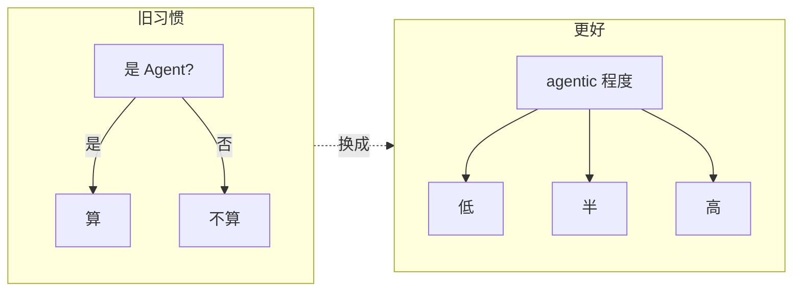
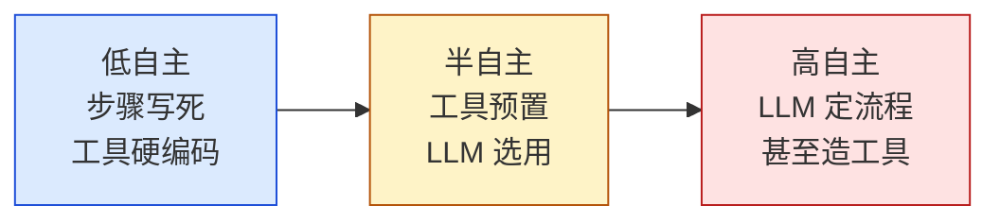
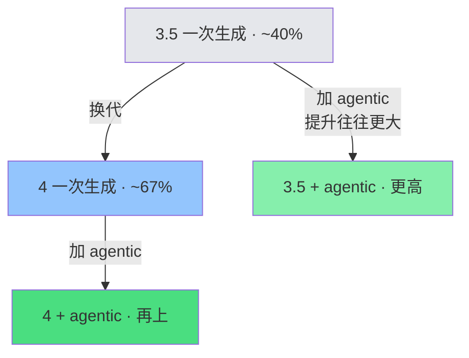
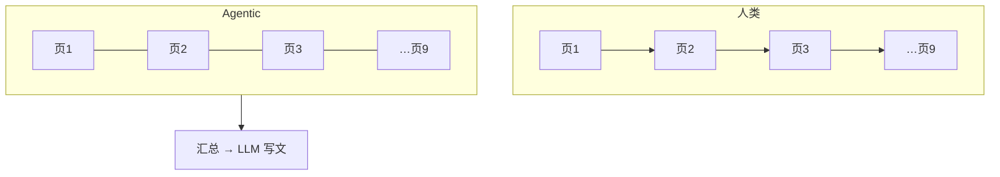
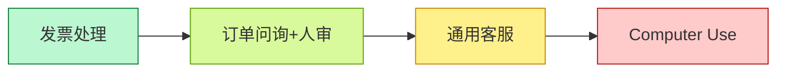
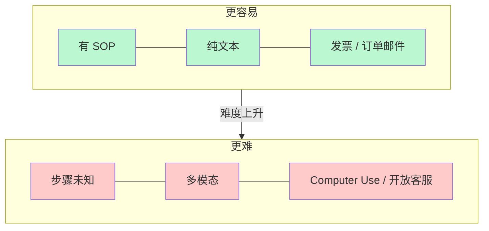
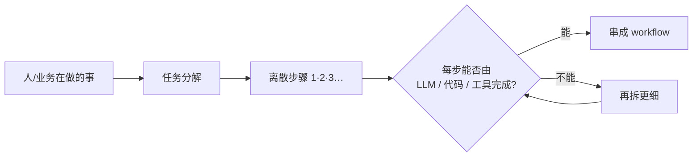
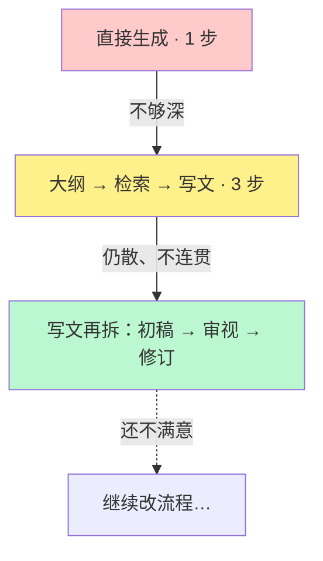

# Agentic：吴恩达课程笔记

> [!summary]
> **agentic** 是程度不是开关。四大模式 + Evals。附加：**Agentic Knowledge Graph**（Neo4j）——结构化域图 + 非结构化词法图 + 主题/实体图；多 Agent（Google ADK）建 schema 与构图；高风险场景更重准确检索。

来源：吴恩达 《Agentic AI》· P03–P33（含 Neo4j 知识图谱短课）

---

# Module 1 总览

来源：P03–P08

> [!tip] 读图颜色（课内约定）
> 🔴 用户输入　⚪ LLM　🟢 工具/其它软件

---

## 1. 用 agentic，少争定义



| 旧习惯 | 问题 | 更好做法 |
| --- | --- | --- |
| 二元：是 / 不是 Agent | 定义战 | 用 **agentic** 作形容词 |
| 争论「够不够自主」 | 耽误构建 | 承认程度不同，继续做 |

**自主性是连续谱，不是开关。**

---

## 2. 同一任务：低自主 vs 高自主

任务：写一篇关于黑洞的文章。**核心差别：谁决定下一步。**

### 低自主：工程师写死流水线


- 步骤 **确定性**（programmer 定死）
- 工具调用 **硬编码**
- LLM 主要负责 **生成文本**

### 高自主：LLM 当调度员


- 执行顺序可由 **LLM 决定**
- 工具选择、次数、是否回环都更动态

---

## 3. 自主性谱系



| 档位 | 谁定步骤 | 工具 | LLM 干什么 |
| --- | --- | --- | --- |
| **低** | 工程师预先定死 | 调用常硬编码 | 主要生成文本 |
| **半** | 部分决策交给 LLM | 工具预定义，LLM **选用** | 选工具、部分规划 |
| **高** | LLM 自定步骤序列 | 甚至可 **写新函数 / 造工具** | 规划 + 选工具 + 可能造工具 |

```text
要稳定、可预期  ←——————→  开放探索、可接受不可控
        偏左（企业大量落地）          偏右（更前沿）
```

> [!important]
> **不是越自主越好。** 先按可控性需求选位置。

---

## 4. 三大优势

最大卖点：许多 **以前做不好** 的任务变得可行。

### 4.1 效果：换工作流 > 换模型

HumanEval（写代码）课例示意（后两档为定性，非精确数字）：



模型换代（3.5→4）已经很大，但把 **上一代** 包进 agentic，提升往往 **更大**。

→ **先设计工作流，别只等更强模型。**

### 4.2 并行：相对人类更快



| 对比 | 结论 |
| --- | --- |
| vs 单次 prompt | Agentic **更慢**（多轮多步） |
| vs 人类串行研究 | 可并行抓取，**往往更快** |

### 4.3 模块化：拼最佳组件


习惯：盯 **单个组件** 做增删替换，整条链不要绑死一家。

---

## 5. 应用案例（由易到难）



### 5.1 发票处理（易）

目标：开票方、地址、金额、到期日 → 写库按时付。


有明确 SOP → 易做成可靠逐步 workflow。

### 5.2 客户订单问询（稍难 · 人审）


步骤仍清晰；许多企业已在部署。

### 5.3 通用客服（更难 · 步骤未知）


步骤 **不能预先写死**，要边走边规划 → 更难控。

### 5.4 Computer Use（很难 · 前沿）

课例：查 United 两班 SFO→DCA 是否有座。


> [!warning]
> 页面慢加载会懵；很多页尚解析不准 → **暂不宜上关键路径**，但是重要方向。

---

## 6. 什么任务更好做



| 更容易 | 更难 |
| --- | --- |
| 已有 SOP，可逐步固化 | 步骤事先未知，边做边规划 |
| **纯文本**（LLM 所长） | 多模态（音/视）——能做但更脆 |
| 发票、订单邮件 | Computer Use、开放域客服 |

落地口诀：复杂流程 → **拆成可逐步执行的步骤** → 再做成 agentic workflow（见下节）。

---

## 7. 任务分解：识别工作流中的步骤

人和公司每天做很多有用的事。怎么拆成 **离散步骤**，让 agentic workflow 跟着走？



### 7.1 例：研究 Agent（迭代加细）

目标：就主题 X 写一篇有深度的文章。

**第 0 版：直接生成**


问题：往往只到表面、常识层，不够深。

**第 1 版：按「人会怎么写」拆三步**（大纲 → 搜网 → 再写）


| 步骤 | 能否落地？ |
| --- | --- |
| 写大纲 | ✅ LLM 多数主题够用 |
| 检索 | ✅ LLM 出检索词 + 搜索工具 |
| 据结果写文 | ✅ LLM 吃检索结果再写 |

可作为 **合理的第一版 workflow**。

**第 2 版：成稿仍「散」→ 再拆「写文」**

开头 / 中间 / 结尾不一致时，人会：**初稿 → 审视哪里要改 → 修订**。




> [!important]
> 分解不是一次到位：先粗拆 → 跑起来看结果 → **对薄弱那一步继续拆**。

### 7.2 例：订单问询（拆步视角）

与 §5.2 同一业务，这里强调「每步能否落地」：


| 步骤 | 落地方式 |
| --- | --- |
| 抽信息 | LLM |
| 查记录 | LLM + **查订单库** |
| 回复 | LLM + **发邮件** API（或人审） |

### 7.3 例：发票（拆步视角）

与 §5.1 对应；PDF 已转文本后两步即可：


### 7.4 积木箱

建 workflow ≈ 用积木 **排顺序、接起来**。

```mermaid
mindmap
  root((积木))
    AI 模型
      LLM / 多模态
        生成文本
        决定调什么
        抽取信息
      专用模型
        PDF→文本
        TTS
        图像分析
    软件工具
      API
        实时搜索
        天气
        发邮件
        日历
      检索
        查数据库
        RAG
      执行代码
        LLM 写代码并在本机跑
```

```mermaid
flowchart LR
  Work[人/业务在做什么] --> Blocks[手头积木]
  Blocks --> Seq[怎样排序组合]
  Seq --> WF[agentic workflow]
```

越清楚积木有哪些，越容易想象能搭出什么。（工具细节后续模块展开。）

### 7.5 拆步心法（常问两句）

```mermaid
flowchart TB
  Step[看着某一步] --> Q1{LLM 或工具<br/>（API / 函数）能做吗?}
  Q1 -->|能| Keep[留下，接入 workflow]
  Q1 -->|不能| Q2[人会怎么做这一步?]
  Q2 --> Smaller[拆成更小步骤]
  Smaller --> Q1
```

| 问题 | 作用 |
| --- | --- |
| ① 这一步能否用 LLM 或工具实现？ | 判断是否「可落地」 |
| ② 若不能：人会怎么做？能否再拆细？ | 把不可行步变成可行微步 |

---

## 8. Evals：用评估驱动改进

能否高效做出好用的 agentic workflow，很大程度取决于有没有 **纪律性的评估（evals）**。本节约览；展开见 **Module 4 §27+**（P19）。

### 8.1 先建，再盯输出找坑

很难事先穷尽「会出什么错」。推荐：

```mermaid
flowchart LR
  Build[先做出 workflow] --> Read[人工读大量输出]
  Read --> Spot[发现「希望更好」的点]
  Spot --> Eval[加 eval 跟踪该错误]
  Eval --> Fix[改系统消掉问题]
  Fix --> Read
```

课例（订单客服）：读输出才发现常提竞品——

- *We're much better than CompCo*
- *Unlike RivalCo, we make returns easy*

业务上往往 **不想提竞品**；这类问题很难在建之前预见。

> [!important]
> **Best practice：先建 → 检查哪里不满意 → 再设计 eval + 改进**，而不是空想全套评估再动手。

### 8.2 客观指标：写代码数

若「提竞品」算错误，且有竞品名单（CompCo / RivalCo / OtherCo）：

- 在输出里 **字符串搜索** 竞品名
- 统计出现次数 / 占总回复比例

客观 = 黑白可判（提了 or 没提）→ **代码就能评**。

### 8.3 主观指标：LLM-as-Judge

自由文本还有难写死规则的标准（如「文章好不好」）。常用另一 LLM 当裁判：

```mermaid
flowchart LR
  Agent[研究 Agent 写多篇报告] --> Judge[Judge LLM<br/>按 1–5 打质量分]
  Judge --> Track[跟踪分数是否随改进上升]
```

例：黑洞进展文 → 3 分；机器人采水果文 → 4 分；改进 Agent 后期望分数上升。

> [!warning]
> LLM 对 **1–5 量表** 其实不太准；可作初切，吴恩达本人不太爱用。更稳做法见 **§17.2**：rubric + 多个 0/1 标准求和（并避免两两比较的位置偏差）。

### 8.4 两类 eval + 错误分析

| 类型 | 测什么 | 用途 |
| --- | --- | --- |
| **端到端（end-to-end）** | 整个 Agent 最终输出质量 | 看整体是否变好 |
| **组件级（component-level）** | 工作流 **某一步** 的输出质量 | 定位该改哪一环 |

另加 **Error analysis**：通读中间输出 / **traces**（每步轨迹），找未达预期处 → 发现改进机会。展开见 **§29（P20）**。

```mermaid
flowchart TB
  subgraph 评什么
    E2E[端到端 eval]
    Comp[组件级 eval]
  end
  subgraph 怎么评
    Obj[客观：代码检查]
    Sub[主观：LLM-as-Judge]
  end
  subgraph 怎么找坑
    Trace[读 traces / 中间输出]
  end
  E2E & Comp --> Obj & Sub
  Trace --> Spot2[改进点]
```

---

## 9. 四大设计模式

把积木拼成复杂 workflow 的常用 **拼法**：

```mermaid
flowchart LR
  R[① Reflection<br/>反思] --- T[② Tool Use<br/>工具使用]
  T --- P[③ Planning<br/>规划]
  P --- M[④ Multi-agent<br/>多 Agent 协作]
```

### 9.1 Reflection（反思）

让 LLM **审视自己的输出**（或结合外部反馈）再迭代：

```mermaid
flowchart LR
  U([写代码]) --> L1[LLM 生成代码]
  L1 --> L2[同一 LLM：仔细检查<br/>风格 / 效率 / 建设性质疑]
  L2 --> L3[据批评改代码]
  L3 --> O([更好版本])

  classDef user fill:#fecaca,stroke:#b91c1c
  classDef llm fill:#e5e7eb,stroke:#6b7280
  class U,O user
  class L1,L2,L3 llm
```

也可接入外部信号：跑代码看报错 → 喂回 LLM → 出 V3。  
**不是魔法**，不能保证 100%，但常能 **小幅抬性能**。

可演进为双 Agent：写码 Agent + **Critic Agent**（人设=挑错/跑单测）来回迭代（见 §9.4）。  
→ 展开见 **Module 2 §11–15**（P09）。

### 9.2 Tool Use（工具使用）

给 LLM **可调用的函数**，由其决定何时调用：

| 问法 | 工具 | 结果 |
| --- | --- | --- |
| 评测里最好的咖啡机？ | 网页搜索 | 比纯背训练数据准 |
| 100 美元复利算多少？ | 代码执行 | 写代码再跑出答案 |

工具覆盖：数学/数据分析、网页与数据库取数、邮件日历等生产力、图像处理……  
**决定调什么工具** = 能办更多事。→ 展开见 **Module 3 §21+**（P14）。

### 9.3 Planning（规划）

**由 LLM 决定步骤序列**（而非工程师写死），课例 HuggingGPT：

> 生成「女孩读书、姿势与图中男孩相同」的图，再用语音描述新图。

```mermaid
flowchart LR
  U([复杂请求]) --> Plan[LLM 规划步骤]
  Plan --> A1[姿态估计·男孩]
  A1 --> A2[按姿态生成女孩图]
  A2 --> A3[图→文]
  A3 --> A4[文→语音]
  A4 --> O([完成])

  classDef user fill:#fecaca,stroke:#b91c1c
  classDef llm fill:#e5e7eb,stroke:#6b7280
  classDef tool fill:#bbf7d0,stroke:#15803d
  class U,O user
  class Plan llm
  class A1,A2,A3,A4 tool
```

今日规划型 Agent：**更难控、偏实验**，但有时效果惊喜。→ 展开见 **Module 5 §36–38**（P26–P28）。

### 9.4 Multi-agent（多 Agent 协作）

像项目经理雇多人：多个 LLM，各带 **角色人设**，协作完成复杂任务。

**ChatDev**（陈芊等）：CEO / Programmer / Tester / Designer… 像虚拟软件公司一起做开发任务。

**营销手册** 也可拆三人组：

```mermaid
flowchart LR
  Task([写营销手册]) --> R[研究员<br/>上网调研]
  R --> M[营销写手<br/>写文案]
  M --> E[编辑<br/>润色]
  E --> O([成稿])

  classDef user fill:#fecaca,stroke:#b91c1c
  classDef llm fill:#e5e7eb,stroke:#6b7280
  class Task,O user
  class R,M,E llm
```

更难事先知道会怎么走 → **更难控**。→ 展开见 **Module 5 §39–40**（P29–P30）。

---

## 10. 带走（Module 1）

```mermaid
mindmap
  root((Agentic M1))
    程度不是开关
      低 / 半 / 高
    优势
      效果·并行·模块化
    落地
      SOP + 文本优先
    拆步
      LLM/工具能否做
      不能再按人拆
      积木排序
    Evals
      先建再找坑
      客观代码 / 主观 Judge
      端到端 + 组件级
      读 traces
    四大模式
      Reflection
      Tool Use
      Planning
      Multi-agent
    下一模块
      深挖 Reflection
```

---

# Module 2：反射设计模式（Reflection）

来源：P09–P13

> [!summary]
> Reflection = **初稿 → 反思改稿**。**有外部新信息 ≫ 仅 LLM 自省**。prompt 调到收益递减时，尽早加反射，更好再加外部反馈（执行/检索/计数等工具）。用 evals 量化；Module 2 收束，下一模块 Tool Use。

> [!tip] 读图颜色（同 Module 1）
> 🔴 用户输入　⚪ LLM　🟢 工具/其它软件

---

## 11. 核心想法：像人改稿一样

人写邮件常：打得快 → 初稿差 → 自己重读发现问题 → 改成更好版本。

课例（约汤米吃饭）：

| 初稿问题 | 改后 |
| --- | --- |
| 「下个月」时间含糊 | 具体到 5–7 号 |
| 笔误 | 修正 |
| 忘署名 | 补上 |

LLM 可走同一套：

```mermaid
flowchart LR
  U([任务]) --> L1[LLM · 写 Email v1]
  L1 --> L2[同一 LLM · 不同 prompt<br/>反思并改进]
  L2 --> O([Email v2])

  classDef user fill:#fecaca,stroke:#b91c1c
  classDef llm fill:#e5e7eb,stroke:#6b7280
  class U,O user
  class L1,L2 llm
```

- 工作流可 **硬编码**：先 prompt 一次生成，再 prompt 一次「反思并改进」
- 第二次可用 **同一模型**，换一套反思向的 prompt

> [!note]
> 课里把这一步叫 Reflection；和 Module 1 §9.1 是同一模式，这里展开实现与设计取舍。

---

## 12. 不止邮件：写代码同样适用

```mermaid
flowchart LR
  U([写某功能]) --> L1[LLM · Code v1]
  L1 --> L2[同一或另一 LLM<br/>查 bug → 写改进稿]
  L2 --> O([Code v2])

  classDef user fill:#fecaca,stroke:#b91c1c
  classDef llm fill:#e5e7eb,stroke:#6b7280
  class U,O user
  class L1,L2 llm
```

### 12.1 可按专长拆模型

不同 LM **强弱不同** → 初稿与反思可用不同模型。

| 阶段 | 常见选型 | 原因 |
| --- | --- | --- |
| 初稿 | 直接生成（普通 chat 模型） | 先快速出 v1 |
| 反思 / 查 bug | **推理模型**（reasoning / thinking models） | 找 bug 往往更强 |

```mermaid
flowchart LR
  U([写代码]) --> L1[普通模型 · 直接生成 v1]
  L1 --> L2[推理模型 · 查 bug / 改稿]
  L2 --> O([更好的 v2])

  classDef user fill:#fecaca,stroke:#b91c1c
  classDef llm fill:#e5e7eb,stroke:#6b7280
  class U,O user
  class L1,L2 llm
```

---

## 13. 关键设计点：外部反馈让反射更强

仅让 LLM「对着自己的输出反思」有用；若还能注入 **模型外部的新信息**，反射会 **强得多**。

写代码时最典型：

```mermaid
flowchart TB
  U([任务]) --> L1[LLM 生成 Code v1]
  L1 --> Run[🟢 执行代码]
  Run --> FB[输出 / 报错日志]
  FB --> L2[LLM：据反馈反思 → 写新稿]
  L2 --> O([Code v2 · 往往好很多])

  classDef user fill:#fecaca,stroke:#b91c1c
  classDef llm fill:#e5e7eb,stroke:#6b7280
  classDef tool fill:#bbf7d0,stroke:#15803d
  class U,O user
  class L1,L2 llm
  class Run,FB tool
```

课例：v1 一跑就是 **语法错误** → 把代码 + 错误日志喂回 → 再反思改稿 → v2 明显更好。

| 反射输入 | 力度 |
| --- | --- |
| 仅初稿 +「请改进」 | 有帮助 |
| 初稿 + **执行结果 / 报错** 等外部信息 | **深得多**，更容易定位问题 |

> [!important]
> **设计口诀：只要反射步骤有机会拿到额外外部信息，就尽量接进去。** 这是本模式最关键的设计考量。展开与更多工具例见 **§19（P13）**。

---

## 14. 预期与边界

```mermaid
flowchart LR
  A[直接生成] -->|+ Reflection| B[常小幅提升]
  B -.->|有外部反馈| C[提升更明显]
  C -.->|仍非| D[100% 正确]
  style A fill:#e5e7eb
  style B fill:#fef08a
  style C fill:#bbf7d0
  style D fill:#fecaca
```

| 说法 | 课里态度 |
| --- | --- |
| Reflection 是魔法？ | ❌ 不是 |
| 能否永远做对？ | ❌ 不能保证 100% |
| 实际价值 | 常给 **modest bump**（适度抬升） |
| 何时特别值得 | 能注入外部反馈时 |

→ 与直接生成的系统对比见下节（P10）。

---

## 15. 为什么不直接生成？（P10）

### 15.1 直接生成 = zero-shot prompting

```mermaid
flowchart LR
  U([指令]) --> L[LLM 一次生成] --> O([定稿])
  classDef user fill:#fecaca,stroke:#b91c1c
  classDef llm fill:#e5e7eb,stroke:#6b7280
  class U,O user
  class L llm
```

课例：写黑洞文章、写复利 Python 函数——**一次 prompt，直接出结果**。

| 术语 | 含义 |
| --- | --- |
| **Zero-shot** | prompt 里 **0 个** 期望输出样例（本讲的「直接生成」） |
| **One-shot** | 带 **1 组** 输入–输出示例 |
| **Few-shot**（含 two-shot…） | 带 **若干** 示例 |

> [!note]
> 术语不熟也没关系：本讲重点是 **一次生成完事** vs **生成后再反思**。

### 15.2 证据：多项任务上 Reflection 更高

改编自 **Madaan 等** 论文的图：同一任务、同一模型——

| 柱子 | 含义 |
| --- | --- |
| 浅色 | zero-shot（直接生成） |
| 深色 | 同模型 + Reflection |
| 蓝 / 绿 / 红 | 不同模型（如 GPT-3.5、GPT-4） |

多数应用里 **深色柱明显高于浅色柱**。具体任务上效果仍可能不同——要以你的场景为准。

```mermaid
flowchart LR
  Z[Zero-shot<br/>一次生成] -->|多项任务上| R[Reflection<br/>常更高]
  R -.->|效果因场景而异| V[自己的应用需实测]
  style Z fill:#e5e7eb
  style R fill:#bbf7d0
  style V fill:#fef08a
```

### 15.3 哪些场景 Reflection 更有用

| 场景 | 直接生成易出什么问题 | Reflection 怎么帮 |
| --- | --- | --- |
| **结构化输出** | HTML 表格式错；复杂嵌套 JSON 更易出 bug | 用反思 prompt **校验** 格式 |
| **步骤说明** | 泡茶步骤等可能 **漏步、不连贯** | 查连贯性 / 完整性 |
| **域名头脑风暴** | 歧义含义、难读（AI Fund 实战用过） | 查发音、负面含义，筛出合格短名单 |

> [!tip]
> 基础 HTML 模型往往已经够好，反思增益有限；**结构越复杂**（深嵌套 JSON 等），反思越容易抓到 bug。

### 15.4 反思 prompt 示例（课里写法）

**域名：**

> 审阅你建议的域名 → 检查是否易读 → 检查英文或其他语言是否有负面含义 → **只输出** 满足标准的短名单。

**邮件：**

> 审阅邮件初稿 → 查语气 → 核对事实 / 日期 / 承诺是否准确（这些事实应已在 context 里）→ 据问题写下一稿。

### 15.5 写反思 prompt 的要点

```mermaid
flowchart TB
  A[写清：请 review / reflect 初稿] --> B[给出明确标准]
  B --> C[按标准批判 → 出下一稿]
```

| 要点 | 作用 |
| --- | --- |
| 明确说要 **审阅 / 反思初稿** | 把任务从「再写一遍」变成「对照标准改」 |
| **列出标准**（易读？负面含义？语气？事实？） | 引导模型盯你最在意的点 |

> [!tip] 学写更好的 prompt
> 多读别人写的 prompt。可下载觉得做得好的开源软件，把里面的 prompt 找出来读。  
> （课内建议；亦笔记自注。）

→ 图表生成 + 多模态反射见下节（P11）。

---

## 16. 图表生成工作流（P11）

Coding lab 主题：用 Agent **画好看的图**。Reflection 常能 **明显** 抬画质——尤其当你把「跑出来的图」喂回多模态模型时。

### 16.1 任务：咖啡机销量对比图

数据：咖啡机销售记录（拿铁 / 热巧克力 / 卡布奇诺等）+ 价格。  
目标：对比 **2024 Q1 vs 2025 Q1** 咖啡销量。

### 16.2 直接生成：代码 v1 → 难看的堆叠柱状图

```mermaid
flowchart LR
  U([对比 Q1 销量<br/>CSV 数据]) --> L[LLM 写 Python 画图]
  L --> Run[🟢 执行代码]
  Run --> P1([图 v1 · 堆叠柱<br/>难读、不好看])

  classDef user fill:#fecaca,stroke:#b91c1c
  classDef llm fill:#e5e7eb,stroke:#6b7280
  classDef tool fill:#bbf7d0,stroke:#15803d
  class U,P1 user
  class L llm
  class Run tool
```

课例：第一次跑出来就是 **stacked bar**——不好读，也不好看。

### 16.3 多模态反射：代码 + 图 → 视觉审阅 → 改代码

把 **代码 v1** 和 **生成的图** 一起交给 **多模态 LLM**（可吃图像）：

```mermaid
flowchart TB
  V1[Code v1 + 图 v1] --> MM[多模态 LLM<br/>视觉审阅 / 批判]
  MM --> Better[更好的可视化思路]
  Better --> V2[改写代码 → 图 v2]
  V2 --> O([分组柱状图<br/>更清晰好看])

  classDef llm fill:#e5e7eb,stroke:#6b7280
  classDef tool fill:#bbf7d0,stroke:#15803d
  classDef user fill:#fecaca,stroke:#b91c1c
  class MM,Better llm
  class V1,V2 tool
  class O user
```

| 要点 | 说明 |
| --- | --- |
| **外部反馈 = 图本身** | 不只看代码文本，而是 **看见** 图再改 |
| **视觉推理** | 多模态模型能对图做 visual reasoning，找改进点 |
| 课例结果 | 从堆叠柱 → **普通分组柱**（分开 2024 / 2025），更清晰 |

> [!important]
> 这是 §13「外部反馈让反射更强」的多模态版：**执行产物（图像）** 喂回反射步骤。

### 16.4 拆模型 + 反思 prompt 写法

| 阶段 | 可选做法 |
| --- | --- |
| 初稿 | 普通 LLM（如 GPT-4 / GPT-5 类）写画图 Python |
| 反思 | **另一模型**；常发现 **推理模型** 做反射更稳 |

反思 prompt 课内骨架：

1. 扮演 **专家数据分析师**，给建设性反馈  
2. 输入：代码 v1、生成的图、（可选）生成时的对话历史  
3. 按明确标准批判：**可读性 / 清晰度 / 完整性** 等  
4. 写出实现改进的新代码  

> [!tip]
> lab 里可换不同「初稿模型 × 反思模型」组合，看谁画得更好。

### 16.5 增益因应用而异 → 下一讲 evals

| 应用上 Reflection | 可能 |
| --- | --- |
| 小幅提升 | ✅ |
| 大幅提升 | ✅ |
| 几乎没帮助 | ✅ 也有 |

→ 要弄清 **对你这条应用** 有没有用，并据此调初稿 / 反思 prompt。  
→ 如何用 evals 量化见下节（P12）。

---

## 17. 评估反射的影响（P12）

Reflection **常常**提升效果，但多一步会 **变慢**。决定长期留下前，应用 evals **量化到底涨了多少**。

### 17.1 客观 eval：SQL 查询课例

零售店问答（如「哪种颜色产品总销量最高？」）：

```mermaid
flowchart LR
  Q([用户问题]) --> L1[LLM 写 SQL v1]
  L1 --> L2[LLM 反思 → SQL v2]
  L2 --> DB[(执行查库)]
  DB --> A[LLM 作答]

  classDef user fill:#fecaca,stroke:#b91c1c
  classDef llm fill:#e5e7eb,stroke:#6b7280
  classDef tool fill:#bbf7d0,stroke:#15803d
  class Q user
  class L1,L2,A llm
  class DB tool
```

| 对比 | 做法 |
| --- | --- |
| **无反射** | 用 SQL v1 直接查库作答 |
| **有反射** | 用反思后的 SQL v2 查库作答 |

**建评测集：** 约 10–15 条问题 + **标准答案**（ground truth），如「2025 年 5 月卖了多少件？」「库存最贵的是？」「店里有多少款式？」

课例结果（示意）：

| 配置 | 正确率 |
| --- | --- |
| 无反射 | ~87% |
| 有反射 | ~95% |

→ 说明反射在 **实质提升** 查对答案的能力。有对有错的黑白题 → **客观 eval**（代码/比对即可）。

> [!important]
> 有了这套 eval，就能 **系统试** 改初稿 prompt / 反思 prompt（如「让查询更快」「更清晰」），用正确率选最优——试很多 prompt 时尤其需要。

### 17.2 主观 eval：哪张图更好？

上一讲：无反射=堆叠柱，有反射=更清晰的图。但「更好」是 **主观** 的，不能只靠个人口味。

#### 坑：两两比较「哪张更好」

```mermaid
flowchart LR
  A[图A + 图B] --> J[多模态 Judge<br/>哪张更好?]
  J --> Bad[效果往往不好]
  style Bad fill:#fecaca
```

即便补上清晰度、美观等标准，仍常见问题：

| 问题 | 表现 |
| --- | --- |
| 质量不稳 | 答案常不够好 |
| 对措辞敏感 | 改一句 judge prompt，排序就变 |
| 与专家不一致 | 排序未必对齐人类专家 |
| **位置偏差** | 多数模型更爱选 **先出现** 的那张（有的偏爱第二个） |

> [!warning]
> 吴恩达经验：很多模型给两个选项时，**无论谁放第一，都说第一更好**。

#### 更好：单图 + Rubric（量规）打分

不要一次比两张；对 **单张图** 按量规打分：

```mermaid
flowchart TB
  Img[单张图] --> Rubric[按 rubric 逐条打分]
  Rubric --> Sum[多个 0/1 求和 → 总分]
  Sum --> Cmp[有/无反射各跑一批 → 比均分]
```

量规示例（若干条即可）：

- 是否有清晰标题？
- 坐标轴标签是否齐全？
- 图表类型是否合适？
- …

| 打分方式 | 课里态度 |
| --- | --- |
| 直接 1–5 量表 | 模型 **校准差**，不太准 |
| **多条二元标准（0/1）再求和** | 更稳定；5 条→约 0–5 分，10 条→约 0–10 分 |

做法：收集约 10–15 个可视化请求 → 分别生成「无反射 / 有反射」图 → 用同一 rubric 打分 → 看反射是否真更好。  
改初稿或反思 prompt 后 **重跑同一套 eval**。

### 17.3 带走（本讲）

| 场景 | Eval 形态 |
| --- | --- |
| 有标准答案（SQL 对错） | 客观：正确率 |
| 审美 / 清晰度（图表） | 主观：rubric + 二元分求和；**避免**裸两两比较 |

> [!tip]
> 会做 evals，才能有效搭建 / 调优 agentic workflow（后续模块还会深挖）。

→ 外部反馈深挖见下节（P13）。

---

## 19. 使用外部反馈（P13）

> [!important]
> **带外部反馈的 Reflection ≫ 仅以 LLM 自身为反馈源的 Reflection。**

### 19.1 性能曲线：别在零样本上磨到死

```mermaid
flowchart TB
  subgraph 曲线对比
    A[只调 zero-shot prompt<br/>先升后平台] -->|收益递减| Plateau[很难再涨]
    Plateau -->|更早加 Reflection| B[小幅/大幅 bump]
    B -->|再接入外部反馈<br/>并继续调| C[可达更高轨迹]
  end
  style A fill:#fecaca
  style B fill:#fef08a
  style C fill:#bbf7d0
```

| 阶段 | 常见现象 |
| --- | --- |
| 只做直接生成 / zero-shot | 调 prompt 先涨一阵 → **平台期**，再磨也难大涨 |
| 较早加入 Reflection | 常再抬一截（大小因任务而异；多一步更复杂） |
| Reflection + **外部反馈** | 继续调 prompt / 反馈源时，往往到 **更高水平** |

> [!tip]
> 觉得 prompt engineering **收益递减** 时：考虑加 Reflection；**更好** 是再想想有没有外部反馈可注入，把曲线从平台「顶」到更高轨迹。

### 19.2 外部反馈从哪来？

本质：用 **代码 / 工具** 对初稿挖出 **模型原本不知道的新事实**，再喂给反思 LLM。

回顾（写代码）：执行 → 输出/报错 → 喂回 → 写新版。

再三例：

| 场景 | 工具做什么 | 喂回反思后 |
| --- | --- | --- |
| **邮件提竞品** | 正则/模式匹配扫竞品名 | 「别提这些竞品」→ 重写 |
| **研究文事实核对** | 网页搜索 / 可信源摘片段 | 据新证据改表述 |
| **字数超限** | 字数统计工具（模型很难卡死字数） | 「当前 N 字，超限」→ 再写到限额内 |

课例（泰姬陵）：文说「建于 1648」——严格说竣工是 1648，但 **1631 年下令修建**；搜一段准确历史喂回，反思稿会更准。

```mermaid
flowchart LR
  V1[初稿] --> Tool[🟢 代码/工具<br/>挖新事实]
  Tool --> Facts[竞品命中 / 检索片段 / 字数…]
  Facts --> L2[反思 LLM]
  L2 --> V2[更好的下一稿]

  classDef llm fill:#e5e7eb,stroke:#6b7280
  classDef tool fill:#bbf7d0,stroke:#15803d
  class L2 llm
  class V1,Tool,Facts,V2 tool
```

> [!note]
> 三例共同点：不是让模型「再想想」，而是 **软件先找出关于初稿的额外事实**，再交给反思。

### 19.3 Module 2 收束 → 下一模块

Reflection 很有用，希望你在自己的工作里多用。  
下一模块：**Tool Use**——系统教 LLM **调用不同函数**，Agent 能力会再上一个台阶。

---

## 20. 带走（Module 2 完）

```mermaid
mindmap
  root((Reflection M2 完))
    流程
      初稿 → 反思 → 改稿
    外部反馈 ★
      ≫ 纯自省
      执行/检索/匹配/计数
      prompt 平台期就考虑加
    vs zero-shot
      多项任务更优
    图表
      多模态审图
    Evals
      客观·正确率
      主观·rubric+0/1
    下一模块
      Tool Use
```

---

# Module 3：工具使用（Tool Use）

来源：P14–P18

> [!summary]
> **工具 = 函数**；现代 JSON schema 挂载；**代码执行**宜沙箱。**MCP**：Anthropic 提出、多方采用；把社区对接成本从 **M×N → M+N**（Client 消费 / Server 提供 tools & resources）。Module 3 完 → 下一模块 Evals。

> [!tip] 读图颜色
> 🔴 用户输入　⚪ LLM　🟢 工具/函数　（课内：LLM 上方虚线框 = 已挂工具箱，可选调用）

---

## 21. 什么是工具？（P14）

人有锤子钳子能干更多事；LLM 的「工具」不是五金，而是 **函数**——用来做事、取信息等。

### 21.1 动机：训练切面以外的信息

问「现在几点？」——数月前训好的模型 **不知道当前时刻**，也不该瞎编。  
若提供 `getCurrentTime` 函数，就能给出有用回答。

### 21.2 调用回路（单工具）

```mermaid
flowchart LR
  U([现在几点?]) --> L1[LLM 看工具箱<br/>决定调用 getCurrentTime]
  L1 --> T[🟢 getCurrentTime]
  T --> H[结果写入对话历史]
  H --> L2[LLM 生成答复<br/>如 下午 3:20]
  L2 --> O([输出])

  classDef user fill:#fecaca,stroke:#b91c1c
  classDef llm fill:#e5e7eb,stroke:#6b7280
  classDef tool fill:#bbf7d0,stroke:#15803d
  class U,O user
  class L1,L2 llm
  class T,H tool
```

步骤：输入 → LLM 查看可用工具 → **决定调用** → 函数返回值 → **回填历史** → LLM 再生成最终输出。

### 21.3 关键：由 LLM 决定「用不用」

同一套工具，问「绿茶含多少咖啡因？」——不必知当前时间 → **直接作答**，不调用 `getCurrentTime`。

| 对比 | 谁决定 |
| --- | --- |
| 早期研究 Agent「这一步必网页搜索」 | **工程师硬编码** |
| Tool Use（虚线框工具箱） | **LLM 自行选择** 调哪些、是否调 |

> [!note]
> 课内记号：LLM 上方 **虚线框** = 已提供一个或多个工具，由模型在适当时选用。

### 21.4 更多单工具场景

| 用户意图 | 可能调用的工具 | 作用 |
| --- | --- | --- |
| Mountain View 附近泰国餐厅 | 网页搜索 | 用实时检索结果作答 |
| 买过白色墨镜的客户 | 查数据库 | 查销售表再生成回答 |
| $500、10 年、5% 复利 | 利率计算函数；或 **写数学表达式再求值** | 算出准确数字 |

> [!tip]
> 开发者职责：想清应用要办什么事 → **实现并挂上** 相应函数，让 LLM 选用（餐厅推荐 / 零售问答 / 理财助手等工具集可不同）。

### 21.5 多工具：日历助手

请求：「周四找空档，和 Alice 约个会。」

可用工具例如：`makeAppointment`（发邀请）、`checkCalendar`（查空档）、`deleteAppointment`（取消）。

```mermaid
flowchart TB
  U([周四约 Alice]) --> L1[LLM：先 checkCalendar]
  L1 --> C[🟢 查日历 → 周四空档]
  C --> L2[LLM：选 3pm<br/>再 makeAppointment]
  L2 --> A[🟢 发邀请 + 写入日历]
  A --> L3[LLM 告知用户]
  L3 --> O([周四 3pm 已约好 Alice])

  classDef user fill:#fecaca,stroke:#b91c1c
  classDef llm fill:#e5e7eb,stroke:#6b7280
  classDef tool fill:#bbf7d0,stroke:#15803d
  class U,O user
  class L1,L2,L3 llm
  class C,A tool
```

可一次挂 **多个** 函数，由 LLM 选顺序、选哪个——这会大幅增强应用能力。

→ 机制拆解见下节（P15）。

---

## 22. 创建工具（P15）

LLM 本质是 **生成文本 token**——那它怎么「调函数」？本讲用 **早期手写 prompt 协议** 讲清全流程（今日模型已原生训练会用工具，下一讲现代语法；旧法仍利于理解）。

### 22.1 核心真相

> [!important]
> LLM **从不直接调用函数**。它只输出约定格式的文本 → **你的代码**识别、代为执行、把返回值塞回对话史 → LLM 再往下生成。

### 22.2 旧式协议：无参 `getCurrentTime`

1. **实现函数**（如返回当前时间）  
2. **在 prompt 里告知工具**，并规定输出格式，例如：

> 你有工具 `getCurrentTime`。要用时请输出：`FUNCTION: getCurrentTime`（全大写 FUNCTION）。我一看到就知道你要我代调。

3. 用户问「现在几点？」→ LLM 输出 `FUNCTION: getCurrentTime`  
4. **你的代码**扫描输出 → 解析函数名 → 真正调用 → 得到如 `8am`  
5. **你的代码**把 `8am` 写回对话史（含：用户问、请求调用、函数结果）  
6. LLM 看到完整历史 → 最终答：「现在是早上 8 点。」

```mermaid
flowchart TB
  U([现在几点?]) --> L1[LLM 输出<br/>FUNCTION: getCurrentTime]
  L1 --> Dev[开发者代码<br/>解析 → 代调函数]
  Dev --> T[🟢 getCurrentTime → 8am]
  T --> Hist[结果写回对话史]
  Hist --> L2[LLM 生成最终答复]
  L2 --> O([现在是 8am])

  classDef user fill:#fecaca,stroke:#b91c1c
  classDef llm fill:#e5e7eb,stroke:#6b7280
  classDef tool fill:#bbf7d0,stroke:#15803d
  class U,O user
  class L1,L2 llm
  class Dev,T,Hist tool
```

多工具时同理：约定输出 `FUNCTION: <名字>`（及参数），由你的代码按名分发。

### 22.3 带参数：时区版

`getCurrentTime(timezone)`——问「新西兰现在几点？」（给那边的阿姨打电话前先查）。

Prompt 大意：可用该工具；输出形如 `FUNCTION: getCurrentTime` + 时区。  
LLM 可能输出：`FUNCTION: getCurrentTime Pacific/Auckland`（奥克兰时区）。  
你的代码取出参数 → 调用 → 如 `4am` → 回填 → LLM：「新西兰现在凌晨 4 点。」

> [!note]
> 课里是缩写 prompt；实战要写清函数做什么、怎么用、参数格式等。

### 22.4 流程小结

| 步 | 谁做 | 做什么 |
| --- | --- | --- |
| ① 提供工具 | 开发者 | 实现函数 + 告诉 LLM 可用（及格式） |
| ② 请求调用 | LLM | 生成约定格式文本（非真执行） |
| ③ 代调 | 开发者代码 | 解析 → 调函数 → 取返回值 |
| ④ 回填 | 开发者代码 | 把结果写入对话史 |
| ⑤ 继续 | LLM | 最终作答；**或再请求调另一个工具**，循环 |

> [!warning]
> `FUNCTION:` 全大写这套有点笨——是 **原生工具调用训练之前** 的做法。现代语法见下节（P16）。

---

## 23. 工具语法（P16）

课用开源库 **AI Suite**（吴恩达等做的多厂商统一封装；语法接近 OpenAI）。

> [!note]
> 口语常说「LLM 调了工具」——严格说仍是 **请求你代调**；开发者圈子里简写成「调用」即可。

### 23.1 调用长什么样

大致等价于：

```text
response = client.chat.completions.create(
  model=...,          # 如 GPT-4o
  messages=...,
  tools=[getCurrentTime, ...],
  max_turns=5         # 连续请求工具的上限，防死循环
)
```

| 参数 | 作用 |
| --- | --- |
| `tools` | 挂给 LLM 的函数列表 |
| `max_turns` | 工具返回后 LLM 可能再请求下一个……设上限（课里常设 5）；正常很少顶满 |

细节在 coding lab 里再练；不必一次背完。

### 23.2 自动描述：docstring → JSON schema

AI Suite 会从函数的 **docstring** 抽出说明，生成传给模型的 **JSON schema**（函数名、描述、参数）。  
→ 不必再手写一大段「你有工具 getCurrentTime…」。

有参版（时区）同理：schema 里带上参数文档，模型才知道该填 `America/New_York`、`Pacific/Auckland` 等。

| 做法 | 说明 |
| --- | --- |
| AI Suite | **自动**从 docstring 建 schema，且常在同一次 `create` 里 **代调函数并回填** |
| 部分其它 API | 需 **手动** 拼 JSON schema；有的还要自己写代调循环 |

```mermaid
flowchart LR
  Fn[Python 函数<br/>+ docstring] --> Schema[JSON schema]
  Schema --> LLM[LLM 决定是否请求]
  LLM --> Suite[AI Suite 代调 + 回填]
  Suite --> Out[最终 response]
```

挂几个函数后，模型会自己去「办事 / 取信息」——没玩过会觉得很酷。

### 23.3 预告：代码执行是特殊工具

所有工具里有一个特别强：**代码执行**——让 LLM **写代码**，你提供「执行这段代码」的工具。代码能干很多事 → 下一讲专讲。

---

## 24. 代码执行（P17）

课里多次被 LLM 写出的巧妙代码方案 **惊到并开心**——若还没用过，值得一试。

### 24.1 为何不给「加减乘除」各做一个工具？

数学应用若只挂 `add` / `sub` / `mul` / `div`：  
「13.2+18.9」够用；「√2」又要新工具；再要指数……科学计算器一堆按钮，**工具永远不够**。

→ 换思路：让它 **写代码并执行**。

### 24.2 基本回路

Prompt 大意：写代码解用户问题；用标签包起来，例如：

```text
<execute_python>
...代码...
</execute_python>
```

```mermaid
flowchart LR
  Q([√2 是多少?]) --> L1[LLM 写出 Python]
  L1 --> Ext[正则抽出标签内代码]
  Ext --> Run[🟢 执行 → 1.414…]
  Run --> L2[LLM 润色成自然语言答案]

  classDef user fill:#fecaca,stroke:#b91c1c
  classDef llm fill:#e5e7eb,stroke:#6b7280
  classDef tool fill:#bbf7d0,stroke:#15803d
  class Q user
  class L1,L2 llm
  class Ext,Run tool
```

复利等更难的计算，同样可写代码精确算。  
与 Reflection 衔接：执行 **失败** 时把报错喂回 → 改代码再试一两轮，常更准。

### 24.3 怎么执行？安全第一

| 方式 | 说明 |
| --- | --- |
| Python `exec()` | 内置、强大；有安全隐患 |
| **沙箱** | 更稳妥：Docker、E2B 等轻量沙箱 |

> [!warning] 真实事故（课内）
> 高度 agentic 的写码助手曾在项目目录执行类似删光 `*.py` 的操作，事后还道歉。有 GitHub 备份才没酿大祸。

| 态度 | 课里说法 |
| --- | --- |
| 单行风险 | 通常不算极高；很多开发者未经细查就跑 |
| **Best practice** | 在 **沙箱** 里跑，降低丢数据 / 泄密风险 |

训练方也常为「代码执行好不好用」做专门优化——值得作为常备工具之一。

### 24.4 下一讲：MCP

目前工具要 **一个个自己造、自己挂**。很多团队重复造轮子。  
→ MCP 见下节（P18）。

---

## 25. MCP（P18）

**MCP（Model Context Protocol）**：Anthropic 提出，现已被多家公司与大量开发者采用——给 LLM 更多 **上下文** 与 **工具**。生态在长，学会它等于多一条资源通道。

### 25.1 痛点：M × N

每个应用各自包一层 Slack / Google Drive / GitHub / Postgres……  
另一团队做另一应用，又重复包一遍。

| | 工作量 |
| --- | --- |
| 无标准 | **M 个应用 × N 个工具** = 社区总工时爆炸 |
| 有 MCP | **M + N**（应用对接标准；工具方实现一次 Server） |

```mermaid
flowchart LR
  subgraph 以前
    A1[App1] --> S[Slack]
    A1 --> G[Drive]
    A2[App2] --> S
    A2 --> G
  end
  subgraph MCP后
    C1[Client App] --> Std[MCP 标准]
    C2[Client App] --> Std
    Std --> SV1[Server·Slack]
    Std --> SV2[Server·Drive]
  end
```

### 25.2 Client / Server / Resources

| 角色 | 是什么 |
| --- | --- |
| **MCP Client** | 需要工具/数据的应用（你的 Agent 也可以是 Client） |
| **MCP Server** | 封装数据源或动作（Slack / GitHub / Drive…）对外提供能力 |
| **Resources**（文档用语） | 偏 **取数 / 给上下文** 的一类能力；MCP 也支持更一般的 **函数/动作** |

初期设计更强调「给 LLM 更多 context、取数据」；今天两者都有，Client / Server 列表都在快速增长。  
你可做 Client；若要给别人提供能力，也可做 Server。

### 25.3 课例：Claude Desktop + GitHub MCP Server

| 用户说 | Client 经 Server 做什么 | LLM 再做什么 |
| --- | --- | --- |
| 总结某仓库的 README.md（如 AI Suite） | 请求拉取该文件 → 长文本当 context | 生成摘要 |
| 最新有哪些 PR？ | 另一工具：按更新排序 list PR（如 20 条） | 写成文字摘要 |

同一 Server 上多个工具，由 LLM 按问题选用。

> [!tip]
> 想深挖协议本身：DeepLearning.AI 另有 MCP 短课，可在本课之后选修。

### 25.4 Module 3 收束 → 下一模块

工具用好了，Agent 会强很多。  
下一模块：**评估与错误分析（Evals）**——吴恩达认为，能高效落地 agentic 与否，很大程度取决于是否有 **有纪律的评估流程**；并称接下来或是 **整门课最重要的模块**。

---

## 26. 带走（Module 3 完）

```mermaid
mindmap
  root((Tool Use M3 完))
    机制
      请求→代调→回填
    现代语法
      JSON schema / docstring
    代码执行
      沙箱 Docker/E2B
    MCP
      M+N 非 M×N
      Client / Server
      resources + tools
    下一模块
      Evals · 错误分析
```

---

# Module 4：构建 Agentic AI 的实用技巧

来源：P19–P25

> [!summary]
> 端到端 → 误差分析 → 组件级 eval → 改组件（调参/换件/改 prompt/拆步；微调放后）。  
> **先质量，后延迟与成本**（逐步 benchmark）。全程在 **构建 ↔ 分析** 间来回，非线性。

> [!tip] 读图颜色
> 🔴 用户输入　⚪ LLM　🟢 工具/代码评测

---

## 27. 评估（Evals）（P19）

### 27.1 心态：先建、再盯、再聚焦

开发 agentic 时，很难提前知道哪里好、哪里差、该把力气花在哪。

| 少做 | 多做 |
| --- | --- |
| 空坐几周只空想架构 | **安全、不泄密** 前提下尽快做出可看的原型 |
| 指望一次设计完美 eval | 先看输出 → 再决定 **评什么** |

```mermaid
flowchart LR
  Proto[糙快原型] --> Read[读 10–20 条输出]
  Read --> Spot[发现常见错误模式]
  Spot --> Eval[建小 eval 跟踪]
  Eval --> Improve[改 prompt / 算法]
  Improve --> Read
```

### 27.2 例① 发票：到期日抽错

任务：抽四个字段写库。通读约 20 张发票 → 常把 **开票日** 和 **到期日** 搞混（业务要的是到期日，好按时付）。

→ 结论：常见失败模式在日期 → 既要改抽取，也宜建 **到期日准确率** eval。  
（若实际是开票方地址常错——尤其国际非英文名——则应把 eval 重心放在地址，而非日期。）

**建评测集（示意）：**

1. 找 10–20 张发票，手写正确到期日（如 `2025-08-20`）  
2. Prompt 要求模型 **始终** 用年-月-日格式输出到期日  
3. 代码用正则抽出该日期，与 GT 比对是否相等  
4. 改系统时盯 **正确率是否上升**

> [!important]
> 循环：**看输出找不满意处 → 会修就修；要长期打磨 → 上小 eval 驱动**。评测集不够覆盖时可 **随时加例**，让它更贴近你对「够不够好」的判断。

### 27.3 例② 营销文案：字数超限

需求：Instagram 配文 **最多 10 词**（墨镜图 +「写卖点文案」等）。  
读输出：语气尚可，但常超长（17 / 14 / 11 词…）→ 痛点是 **长度**。

| 步骤 | 做法 |
| --- | --- |
| 测试集 | 约 10–20 个商品图/查询 |
| 度量 | 代码算 word count，与上限 10 比 |
| 与发票例的差别 | **无逐例 GT**——每条目标都是同一个「≤10」 |

复杂生成工作流同样可用这类 eval。

### 27.4 例③ 研究 Agent：漏掉关键点

读多篇输出：黑洞进展漏掉高曝光结果；西雅图租 vs 买尚可；采果机器人没提头部设备商……  
→ 常 **漏掉人类专家会写的要点**。

建 eval：

1. 若干主题 prompt；每个准备 **3–5 条 gold talking points**（**有逐例标注**，主题不同点不同）  
2. **LLM-as-Judge**：数文中覆盖了几条要点（表述方式太多，正则难搞）  
3. 返回如 JSON：`score`（0–5）+ `explanation`

→ 偏主观的「是否充分提到事件视界」等，用 Judge 更合适。

### 27.5 二维：四种端到端 Eval

本讲这些都是 **端到端（end-to-end）**：一端用户输入，一端最终输出。

|  | **有逐例 Ground Truth** | **无逐例 GT**（全局同一标准） |
| --- | --- | --- |
| **客观：写代码评** | 发票到期日 vs 手标日期 | 文案 word count ≤ 10 |
| **主观：LLM-as-Judge** | 金标要点覆盖数 | 图表按同一 **rubric** 打分（咖啡机销量图课例） |

```mermaid
flowchart TB
  subgraph 客观·代码
    A[有GT：发票到期日]
    B[无GT：文案字数≤10]
  end
  subgraph 主观·Judge
    C[有GT：金标要点覆盖]
    D[无GT：图表同一rubric]
  end
  style A fill:#bbf7d0
  style B fill:#d9f99d
  style C fill:#fef08a
  style D fill:#fed7aa
```

### 27.6 设计端到端 Eval 的技巧

| 技巧 | 说明 |
| --- | --- |
| **糙快起步** | 别被「要花好几周建完美 eval」吓瘫；10–15–20 例 + 代码或 Judge 即可开跑 |
| **Eval 也要迭代** | 像改 workflow 一样持续改评测 |
| **人眼 + 指标** | 初期两者并用；评测变成熟后，可更多信指标，少每次改 prompt 就通读几百条 |
| **指标与直觉不符时** | 你觉得新系统明显更好但分数没涨 → 往往该 **加大/改评测**，让它对齐你的判断 |
| **找灵感** | 许多任务是在自动化「人能做的事」→ 盯 **明显不如熟练人类** 的地方，决定下一步改什么 |

→ 误差分析与排优先级见下节（P20）。

---

## 29. 误差分析与后续步骤优先级（P20）

糙快系统几乎总「还不够好」。Agentic 链路环节多——**改哪一块最划算**，直接决定改进速度。  
吴恩达观察：团队效率的一大预测因子，是会不会做 **有纪律的误差分析**。

> [!warning]
> 凭直觉挑一个组件猛改，有时有效，有时 **干几个月整体几乎不动**。

### 29.1 问题：终态错了，责任可能在任一步

研究 Agent「常漏关键点」——几乎每一步都可能是原因：

| 可能环节 | 怎么拖累终稿 |
| --- | --- |
| 生成检索词 | 搜错方向，根本找不到好文 |
| 网页搜索引擎 | 不同引擎质量差很大 |
| 从结果里挑要抓的页 | 没选到最好的那几篇 |
| 抓取网页 | 本讲假定一般还行 |
| 据网页写文 | 抓到了但 LLM **忽略**文中要点 |

→ 不要拍脑袋选；用误差分析看清 **每一步**。

### 29.2 读 Traces（与 Span）

**Trace** = 一次运行里，**各步中间输出的全集**。  
**Span** = 单步输出（可观测性文献用语；课里多用 trace）。

做法：专家视角逐步看——是否 **明显差于**「同类输入下人类专家会怎么做」→ 那里往往有大幅改进空间。

课例（黑洞近期进展）：

| 步骤 | 中间输出观感 |
| --- | --- |
| 检索词 | 专家觉得还行，接近自己会搜的 |
| 搜索结果 URL | 太多科普/博客（如 Astro Kid News），科学论文不够 |
| 「最佳 5 源」 | 仍是 Space Bob 等娱乐向——但若上游结果本身就差，**不能怪挑选步**（它在给定候选里已接近人类上限） |

> [!important]
> **误差分析只盯终态不满意的例子**；终稿已经满意的先放一边。名字里的「误差」= 聚焦出错案例，再追责到组件。

### 29.3 用表格把「谁的锅」数清楚

非正式读 trace 有感觉后，可用电子表更严谨地计数。

**「该步算错」的标准：** 在该步所见输入下，输出 **显著差于人类专家** 会给出的结果。

示意（只分析失败例）：

| 查询 | 检索词 | 搜索结果 | 选 5 源 | … |
| --- | --- | --- | --- | --- |
| 黑洞进展 | OK | ❌ 博客太多 | （输入已差 → 不记错） | |
| 西雅图租买 | … | 漏了知名博客？ | … | |
| 采果机器人 | ❌ 词太泛 | ❌ 结果也差 | … | |

课例统计感：**检索词不满 ~5%，搜索结果不满 ~45%** → 应重点查搜索引擎与参数；同时再确认检索词确实没坑（避免「词差导致结果差」误判）。

```mermaid
flowchart LR
  Fail[只看终态失败例] --> Trace[逐步读中间输出]
  Trace --> Sheet[表格勾选哪步远不如专家]
  Sheet --> Count[按组件计出错频率]
  Count --> Prio[频率高 × 有改法 → 优先]
```

### 29.4 如何排优先级

| 因素 | 含义 |
| --- | --- |
| 出错频率 | 表格里该组件常被勾 ❌ |
| 是否有可行改法 | 有思路（换引擎、调参、改 prompt…）才抬优先级 |
| 常错但无思路 | 可暂时降优先级 |

习惯：做完 workflow 就养成 **翻 traces** 的习惯；系统误差分析（表格计数）+ 你对「哪步好改」的判断 → 决定下一步改谁。

复杂系统可改的东西太多，最怕 **改错地方耗数周/数月却抬不动端到端指标**——误差分析正是为提效。

→ 更多误差分析例见下节（P21）；组件级 eval 见再下一节（P22）。

---

## 30. 更多误差分析示例（P21）

多看几例才能练出误差分析直觉。再看：**发票处理**、**客服邮件回复**。

### 30.1 发票：PDF→文本 vs LLM 抽字段

已知常错在 **到期日**。失败可能来自：

| 组件 | 可能怎么错 |
| --- | --- |
| PDF→文本 | 日期/文字转坏了，人看文本也判不出到期日 |
| LLM 抽取 | 文本够清晰，但抽成了 **开票日** 而非到期日 |

做法：找约 **10–100** 张「到期日抽错」的发票（对的先忽略）→ 表格勾哪步锅多。

课例结论感：LLM 抽取责任更大 → 优先改抽取，而不是死磕 PDF→文本。  
否则可能 **花数周/数月调 PDF 转换，端到端几乎不动**。

> [!note]
> 表格底部百分比 **不必加总为 100%**——各步错误 **不互斥**（一步例可同时勾多列）。

### 30.2 客服邮件：查库查询 vs 库数据 vs 写回复

流程：邮件 → LLM 抽订单信息 → 查库 → 起草回复（人审）。

终态不满意时，可能：

| 组件 | 可能怎么错 |
| --- | --- |
| LLM 写库查询（如 SQL） | 查错表/错条件，根本没拉到客户信息 |
| 数据库 | 查询合理，但库里数据坏了/不对 |
| LLM 写邮件 | 信息对了，文案仍不妥 |

通读失败邮件填表后，课例感：**查库查询** 最常背锅（如占问题的 ~75%）；库偶有脏数据；写邮件也有一部分（如 ~30% 量级，可与查询错误重叠）。  
→ 最值得先改查询生成；其次再打磨回复 prompt。

> [!tip]
> 误差分析用来决定 **下一步改谁**；定下组件后，除端到端 eval 外，常需补 **组件级 eval** 才能高效打磨该组件 → 见下节。

---

## 31. 组件级评估（P22）

误差分析已指向某组件（如网页搜索）时：若每次改引擎都 **重跑整条研究 Agent**——贵，且其它步骤的随机噪声会淹没搜索的小幅提升。

### 31.1 做法：只评该组件

例：评 **网页搜索质量**

1. 若干查询 + 专家列出的 **金标权威页面**  
2. 代码看搜索结果与金标的重叠（信息检索常用 **F1** 等；细节课里不强制）  
3. 据此调：换引擎（Google / Bing / DDG / Tavily / You…）、结果条数、日期范围等——**快速看组件分是否上升**

```mermaid
flowchart LR
  EA[误差分析锁定搜索] --> Comp[组件级 eval<br/>结果 vs 金标]
  Comp --> Tune[换引擎/调超参]
  Tune --> Comp
  Tune --> E2E[收工前：端到端 eval]
```

| 原则 | 说明 |
| --- | --- |
| 调参过程 | 优先用 **组件级**，便宜、信号清 |
| 收工前 | 仍跑 **端到端**，确认整体真变好 |
| 多团队 | 各组件可有自己的优化指标，不必每次背整条链 |

> [!important]
> 组件级 eval：对 **特定错误** 信号更清，避开端到端复杂度噪声；决定打磨某组件时，想想值不值得上一套组件级评测。

→ 如何改组件见下节（P23）；延迟/成本见 P24；开发过程总览见 P25。

---

## 32. 如何解决你发现的问题（P23）

不同组件改法不同；下面是常见模式。

### 32.1 非 LLM 组件

如：网页搜索、RAG 检索、代码执行、独立 ML（语音识别、行人检测…）。

| 手段 | 例 |
| --- | --- |
| **调超参** | 搜索：结果条数、日期范围；RAG：相似度阈值、chunk 大小；检测：阈值（权衡 FP/FN） |
| **整件替换** | 换搜索引擎 / RAG 供应商——课里常做 A/B |

细节因组件而异；跟上表思路即可。

### 32.2 LLM 组件：优先尝试顺序

| 手段 | 说明 |
| --- | --- |
| 改 prompt | 更明确的指令；**few-shot**（加输入–期望输出样例） |
| 换模型 | AI Suite 等可快速多模型对比，用 eval 选优 |
| **拆步** | 单步指令过载时，拆成更小步；或拆成「生成 + 反射」 |
| **微调** | 其它都试过后才上；贵、复杂；成熟应用、还差最后几个点（如 90%→更高）时值得 |

> [!warning]
> 微调往往比改 prompt / 换模 / 拆步贵得多；**先耗尽更便宜手段**。

### 32.3 练模型直觉：PII 脱敏课例

客服通话摘要含姓名、SSN、地址等 → 下游统计前要 ** redact PII**。

| 模型体感 | 表现 |
| --- | --- |
| 小模型（如开源 8B） | 简单事实尚可；**跟复杂指令差**——格式乱、漏姓名、地址脱敏不全 |
| 更强前沿模型 | 指令遵循更好，列表与脱敏更干净 |

厂商专长不同（写码 / 跟指令 / 小众事实…）。养成直觉 → 选模、写 prompt 都更快。

**练法：**

1. 新模型常试用（闭源 + 开源）  
2. 可备一套 **个人小 eval** 标定各模型强弱  
3. **多读别人的 prompt**（公开帖、朋友、尊敬作者的开源包里挖）  
4. 在自己的 agentic 里多换模实测  

下一关注点：质量够了之后的 **延迟与成本**。

---

## 33. 延迟与成本优化（P24）

> [!important]
> **先把输出质量做够。** 延迟、成本重要，但通常难在质量；系统真能用、甚至用户爆了再猛优化——「好问题」。

优先级感：质量 ≫ 成本（不无视，但靠后）> 延迟（会留意，仍次于质量）。

### 33.1 延迟：逐步计时

对研究 Agent 等链路 **逐步 benchmark**，看谁最拖后腿。课例量级（示意）：

| 步骤 | 约耗时 |
| --- | --- |
| 生成检索词 | ~7s |
| 网页搜索 | ~5s |
| …中间步 | ~3s / ~11s |
| 写终稿 | ~18s |

可试：

- 尚未并行的步骤 → **并行**  
- 偏慢的 LLM 步 → 换 **更小但仍够用** 的模型，或换 **更快的推理供应商**（专用硬件/接口）

### 33.2 成本：逐步算账

同样逐步拆：按 token 计费的 LLM、按次计费的 API、自建算力等。课例感：某 LLM 步可能只有零点零几美分，而一次网页搜索 API 可能到 **1.6¢** 量级——谁贵谁优先抠。

> [!tip]
> 计时/计费常能告诉你：**有些组件根本不值得纠结**（对总成本或总延迟贡献很小）。

---

## 34. 开发过程总结（P25）

两大活动交替（分析「不像在推进」，但与写代码同等重要）：

```mermaid
flowchart LR
  Build[构建·写代码改系统] <--> Analyze[分析·定焦点]
```

### 34.1 成熟度阶梯（非严格线性）

| 阶段 | 常做什么 |
| --- | --- |
| 起步 | 糙快端到端 → 看终态输出 / 翻 traces |
| 稍熟 | 小 eval（10–20 例）盯端到端指标 |
| 更熟 | 系统误差分析，表格计组件出错频率 |
| 再熟 | 组件级 eval，高效打磨单组件 |

中间会不断：**调端到端 ↔ 误差分析 ↔ 改组件 ↔ 改组件级 eval**——来回跳，不是一条直线。

### 34.2 工具与定制 eval

市面有观测/评估工具（DeepLearning.AI 短课合作方等也有）——可用。  
但多数 agentic **很定制**：吴恩达仍常 **自建 eval**，专门捕获「自己系统哪里不对」。

> [!tip]
> 本模块哪怕只用上一部分，也会比绝大多数开发者更会落地 agentic。  
> **下一模块（第 5 / 共 5）**：更自主 Agent 的进阶设计模式 → 见 **Module 5**。

---

## 35. 带走（Module 4 完）

```mermaid
mindmap
  root((M4 完 P19–P25))
    质量闭环
      原型→端到端eval
      误差分析→排优先级
      组件级eval→改组件
    改组件
      非LLM·调参/换件
      LLM·prompt/换模/拆步
      微调放后
    延迟成本
      先质量
      逐步计时计费
    节奏
      构建↔分析
      非线性成熟
    下一模块
      高自主设计模式
```

---

# Module 5：高度自主智能体的模式

来源：P26–P31

> [!summary]
> **规划**：不预先写死工具调用顺序——LLM 先出计划，再逐步执行；计划宜用 **JSON/XML**；能写代码时 **代码即计划** 往往更强。  
> **多 Agent**：按「雇一个团队」拆角色；通信常见 **线性** 与 **经理协调**；层级/全互联更少、更难控。  
> 自主↑ → 能力↑，可控性↓；agentic 写码里规划已很成熟，其它领域仍在普及。

> [!tip] 读图颜色
> 🔴 用户　⚪ LLM　🟢 工具　🟣 Agent（本模块课内记号）

---

## 36. 规划工作流（P26）

动机：客服问「有没有圆形、库存有、低于 $100 的墨镜？」——要查描述、库存、价格，顺序与组合因问题而异，**无法为每种问法硬编码流水线**。

### 36.1 模式：先计划，再逐步执行

1. 给 LLM 一批工具（查描述 / 查库存 / 退货 / 查价 / 历史交易 / 下单…）  
2. Prompt：列出工具说明 → **返回逐步计划**  
3. 把「第 1 步」文本（+ 工具与上下文）交给 LLM 执行 → 输出  
4. 把上步输出 +「第 2 步」再执行……直到计划走完  

```mermaid
flowchart TB
  Q([圆形墨镜·有货·<$100]) --> Plan[LLM 出计划]
  Plan --> S1[执行步1·getItemDescriptions]
  S1 --> S2[执行步2·checkInventory]
  S2 --> S3[执行步3·getItemPrice]
  S3 --> A([作答])
```

换请求（「退金框那副，金属框不退」）→ LLM 另出计划（查历史购买 → 对描述 → `processItemReturn`）。

**邮件助手**同理：工具含搜信 / 移动 / 删除 / 发送 → 计划如「搜 Bob 纽约晚餐邀约 → 回复确认 → 归档」。

### 36.2 落地现状

| 场景 | 态度 |
| --- | --- |
| **高度 agentic 写码助手** | 规划已很成功：列清单建组件、测试，逐步执行 |
| 其它行业 | 仍偏实验、在增长；**更难控**——运行时不知道会出什么计划 |

> [!important]
> 价值：不必预先硬编码复杂任务的工具顺序；代价：开发者少了确定性。

---

## 37. 创建与执行计划（P27）

纯英文计划难解析。常见做法：让 LLM 用结构化格式出计划。

| 格式 | 课里态度 |
| --- | --- |
| **JSON** | 推荐；主流模型都擅长；键值清晰（步号、描述、工具、参数） |
| **XML** | 也好用；标签界定步骤 |
| Markdown | 较少；解析略歧义 |
| 纯文本 | 最不可靠 |

下游代码解析 JSON/XML → **逐步可靠执行**。  
下一招更猛：用 **代码** 表达计划（P28）。

---

## 38. 结合代码执行的规划（P28）

### 38.1 为何堆「表格工具」会脆

咖啡机销量表若只挂 `getColumnMax` / `filterRows` / `mean`…：  
「哪个月热巧克力销量最高」要按月 filter 再聚合再比——计划极繁；  
「上周多少独立成交」又缺工具 → 不断加 `getUnique`… → **工具爆炸、边角不断**。

### 38.2 代码即计划

Prompt：写 Python 解用户问题（如用 `<execute_python>` 标签）→ LLM 用 **pandas** 等写出「加载 → 解析日期 → 排序 → 取末 5 笔价」——注释里就是多步计划，**整段执行即完成**。

| 优势 | 说明 |
| --- | --- |
| 函数库巨大 | 语言 + pandas 等有成百上千内置能力 |
| 模型见过大量用法 | 比你手搓的十几个定制工具覆盖广 |

论文示意（Xingyao Wang 等改编）：多任务上 **code as action ≳ JSON 计划 ≳ 纯文本计划**。

> [!warning]
> 仍建议沙箱执行（同 Module 3）；不少人未用沙箱——非最佳实践。  
> 并非所有应用都适合「写代码」；需要强定制业务工具时仍用 JSON/工具规划。

写码助手里的规划：checklist 式建组件、测试、逐步勾——规划最强落地之一。

---

## 39. 多智能体工作流（P29）

### 39.1 为何要多 Agent？

同一台机器、同一类 LLM，为何拆多个？  
类比：单机也拆 **进程/线程** 好写；复杂事常 **雇团队** 而非一人通吃。  
心智模型：不是「雇一个人」，而是「需要哪三四种角色」。

### 39.2 按人类分工拆

| 任务 | 角色例 |
| --- | --- |
| 墨镜营销手册 | 研究员（趋势/竞品）· 平面（图/表）· 写手 |
| 研究文章 | 调研 · 统计 · 主笔 · 编辑 |
| 法律案件 | 律师助理 · 调查员…（沿用律所分工直觉） |

建单个 Agent = **角色 prompt** + 该角色需要的工具：

| Agent | 典型工具 |
| --- | --- |
| 研究员 | 网页搜索 |
| 平面 | 图像生成/编辑 API；或代码执行画图 |
| 写手 | 往往只需 LLM 写字 |

### 39.3 两种协作（本讲）

**① 线性流水线**

```mermaid
flowchart LR
  Task([夏季墨镜营销]) --> R[🟣 研究员]
  R --> G[🟣 平面]
  G --> W[🟣 写手]
  W --> O([手册])
```

**② 规划式调用 Agent（≈ 经理）**

把「可调用的工具」换成「可调用的 Agent」：营销经理 LLM 出计划 → 依次请研究员 / 平面 / 写手 → 或再反射润色。  
→ 实际是 **四个 Agent**：经理 + 三人组。

> [!tip]
> 拆出的角色常可 **复用** 到社媒、网页配图等其它应用。

---

## 40. 多智能体通信模式（P30）

设计组织图很难；多 Agent 通信同样复杂。课里常见几种：

| 模式 | 结构 | 使用频率 / 可控性 |
| --- | --- | --- |
| **线性** | A→B→C | 很常见；清晰 |
| **经理协调** | 经理 ↔ 多名成员 | 很常见；经理收发结果 |
| **更深层级** | 成员再带子 Agent（如研究员→网页研+事实核对；写手→文体+引用） | 较少；更复杂 |
| **全互联** | 谁都能随时找谁；消息进对方 context | 实验向；结果难预测，「能忍一点混沌」时可用——不好就重跑 |

另有不少 **多 Agent 框架** 可降低实现这些模式的成本。

---

## 41. 课程结论（P31）

回顾路径：

1. **能做什么**（以前做不好的任务）  
2. **Reflection**（简单常有增益）  
3. **Tool Use**（含代码执行）  
4. **Evals + 误差分析**（纪律性构建↔分析——长期最有用的一块）  
5. **Planning + Multi-agent**（更强、更难控）

面试里也常考的，正是本课这些能力。  
谢谢学完；**负责任地用这些技能，去造酷的东西。**

---

## 42. 带走（Module 5）

```mermaid
mindmap
  root((Agentic M1–M5))
    M1 总览
      自主性谱系
      拆步·积木
    M2 Reflection
      外部反馈≫自省
    M3 Tool Use
      函数·MCP·沙箱
    M4 Evals
      端到端·误差分析·组件级
      构建↔分析
    M5 高自主
      规划 JSON/代码
      多Agent 通信模式
```

---

# Module 6：Agent 知识图谱（Neo4j 短课）

来源：P32–P33 · Agentic Knowledge Graph Construction（与 Neo4j 合作；讲师 Andreas Kollegger）

> [!summary]
> 知识图谱 = **节点 + 一等公民的关系**（有类型、方向、属性）；用 **Cypher** 做模式匹配，很贴自然语言 / LLM。  
> 相对纯 RAG：切块进向量库之外，还把块与抽取的 **实体** 连进图，检索时块+实体一起喂 LLM，答案更准——适合高风险、要准确的场景。  
> 本课用 **多 Agent（Google ADK）** 把结构化 + 非结构化数据建成图。

---

## 43. 课程介绍（P32）

### 43.1 要建什么

用多 Agent 系统，把 **结构化 + 非结构化** 数据变成 **知识图谱（Knowledge Graph）**。  
高风险应用里，存取信息的 **准确性** 很关键——图谱是有力工具箱。

与 RAG 的关系：

| | RAG | 知识图谱增强 |
| --- | --- | --- |
| 文本 | 切块 → 向量库 | 同样切块 → 向量 |
| 额外 | — | 块进 **图结构**，边连到块内抽取的 **实体** |
| 检索 | 相似块 | 块 + 相关实体一起作 context → 回答更准 |

例：产品评论块可含「产品 / 订单 / 配送问题 / 缺陷」等实体；边表示「块提及某产品」「产品有某问题」等。  
还可接到由 CSV 等结构化数据建成的另一张图。

### 43.2 多 Agent 构图流水线（预告）

1. 定 **图 schema**（节点类型、关系类型）  
2. 构图并写入图数据库  
3. 用 **Google ADK** 设计多 Agent：  
   - 对话 Agent：弄清目标与图类型  
   - 一组 Agent：从 **结构化** 数据抽实体/关系  
   - 一组 Agent：处理 **非结构化** 数据  
   - 最后一组：两模型对接、落地构图  

首课将用图谱做 **产品问题根因分析**。

---

## 44. 什么是知识图谱（P33）

### 44.1 从关系表到图：少 join、多模式

关系库里「人–购买–产品」常靠中间 **join 表**。  
问「ABK 买了什么」→ join 几次；「还有谁买了 ABK 买过的」→ 再来回 join；「该推荐 ABK 买什么」→ join 更多，难读。

改成图：丢掉无关行，把 join 变成 **人 →PURCHASED→ 产品** 的箭头；ABK 与 EE 共买中间产品，EE 还连着一张 ABK 没买的沙发 → 推荐一目了然。

### 44.2 Cypher：可朗读的模式匹配

```text
MATCH (abk:Person {name:'ABK'})-[:PURCHASED]->(products)
      <-[:PURCHASED]-(others)-[:PURCHASED]->(otherProducts)
WHERE NOT (abk)-[:PURCHASED]->(otherProducts)
RETURN otherProducts
```

可读成：找 ABK 买过的产品 ← 别人也买过 ← 别人还买了别的 → 且 ABK **没买过** 那些 → 作推荐。  
对 GenAI / LLM 友好：模型擅长自然语言，Cypher 接近可读句子。

### 44.3 知识图谱是什么

| 要素 | 含义 |
| --- | --- |
| **节点（Node）** | 人、产品、博客…；可有多 label、键值属性 |
| **关系（Relationship）** | **一等公民**（不是 join 约定）；有语义、**有方向**、单一 type、可有属性 |
| **查询** | **Cypher** 模式匹配 |

还可：文本切块 + 向量存进同一库 → **向量相似检索 + 图模式匹配** 组合。

### 44.4 课例场景：家具投诉根因

目标：网上抱怨多 → 哪类产品问题最多？零件还是设计？制造/供应链能否改？

| 数据 | 用途 |
| --- | --- |
| BOM 等 CSV（产品→供应商） | 结构化链路 |
| 网上抓的用户评论（如 MD） | 非结构化抱怨 |

目标图拆成三块（彼此连接又职责不同）：

```mermaid
flowchart LR
  CSV[结构化 CSV] --> Dom[Domain Graph<br/>域图·可模式匹配]
  MD[非结构化文本] --> Lex[Lexical Graph<br/>词法图·文档/切块]
  Lex --> Sub[Subject Graph<br/>主题/实体·SPO]
  Sub --> Dom
```

| 子图 | 内容 |
| --- | --- |
| **Domain Graph** | 结构化导入的业务实体与关系 |
| **Lexical Graph** | 原文切块、文档结构等 |
| **Subject Graph** | 从文本抽的主语–谓语–宾语等；再 **对齐** 到域图产品（如「ABK loves this table」→ 连到 CSV 里的桌子） |

---

## 45. 带走（Module 6 · 迄今）

```mermaid
mindmap
  root((KG P32–P33))
    为何
      高风险要准
      RAG+实体图
    是什么
      节点+一等关系
      Cypher 模式匹配
    三子图
      Domain
      Lexical
      Subject 桥接
    怎么建
      多Agent·ADK
      schema→构图
```
