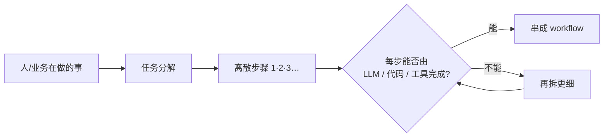
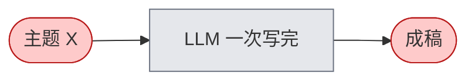
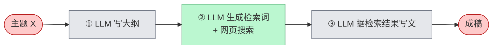
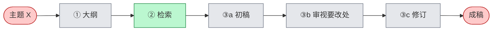
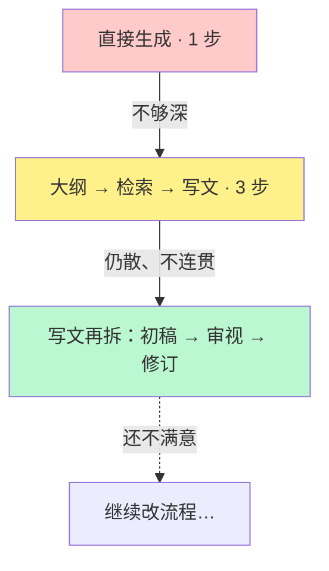
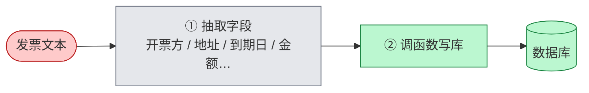
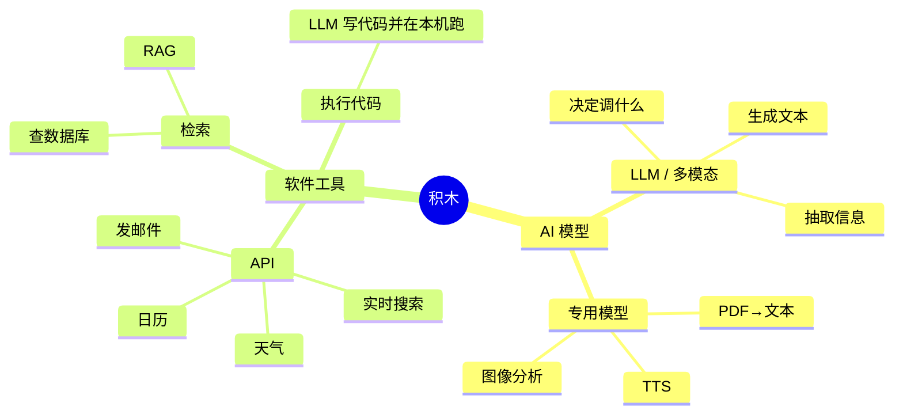
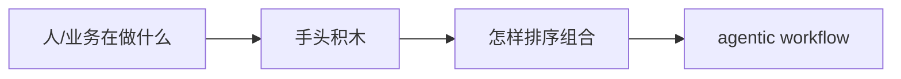
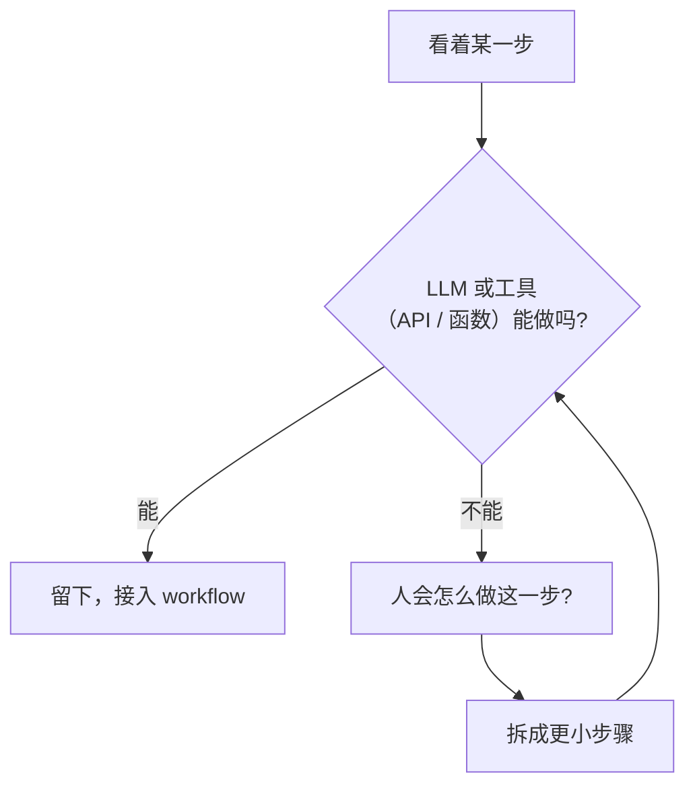
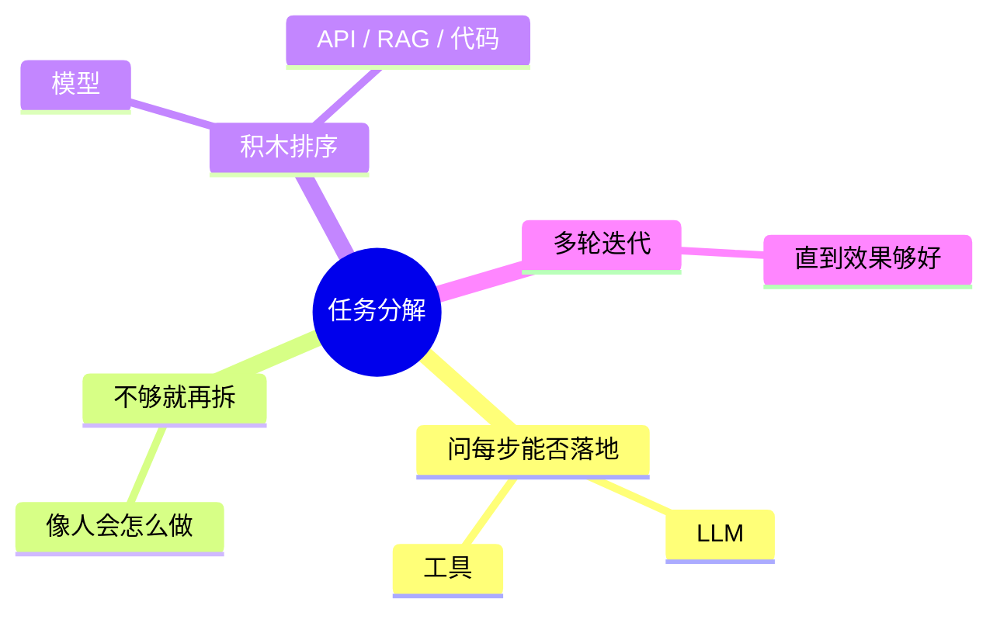

# 任务分解：识别工作流中的步骤

> [!summary]
> 建 agentic workflow 的关键技能：把「人/业务在做的事」拆成 **离散步骤**，每步问：**LLM、短代码、函数调用或工具 能不能做？** 做不了就再拆。先粗拆 → 看效果 → 对薄弱步 **继续分解**；积木是 LLM / 专用模型 / API·检索·跑代码。下一讲：**Evals**。

来源：吴恩达 《Agentic AI》· P06  
前置：[[02_Agentic]]

> [!tip] 读图颜色
> 🔴 用户输入　⚪ LLM　🟢 工具/其它软件

---

## 1. 核心问题

人和公司每天做很多有用的事。怎么把它拆成 **离散步骤**，让 agentic workflow 跟着走？

---

## 2. 例一：研究 Agent（迭代加细）

目标：就主题 X 写一篇有深度的文章。

### 2.1 第 0 版：直接生成

问题：往往只到表面、常识层，不够深。

### 2.2 第 1 版：按「人会怎么写」拆三步

人通常不会一上来就终稿，而是：大纲 → 搜网 → 再写。

每步自检：

| 步骤 | 能否落地？ |
| --- | --- |
| 写大纲 | ✅ LLM 多数主题够用 |
| 检索 | ✅ LLM 出检索词 + 搜索工具 |
| 据结果写文 | ✅ LLM 吃检索结果再写 |

比直接生成更深，可作为 **合理的第一版 workflow**。

### 2.3 第 2 版：成稿仍「散」→ 再拆「写文」

实现后可能发现：开头 / 中间 / 结尾不一致、不连贯。

人会怎么改？不是一次写死，而是：**初稿 → 审视哪里要改 → 修订**。

演进一览：

> [!important]
> 分解不是一次到位：先粗拆 → 跑起来看结果 → **对薄弱那一步继续拆**。

---

## 3. 例二：订单问询邮件

| 步骤 | 落地方式 |
| --- | --- |
| 抽信息 | LLM |
| 查记录 | LLM + **查订单库** 的函数/工具 |
| 回复 | LLM + **发邮件** API（或先入人审队列） |

三步都能对上「LLM 或 LLM+工具」→ 可实施。

---

## 4. 例三：发票处理（更短）

PDF 已转成文本之后：

两步就够：抽取（LLM）→ 落库（工具）。

---

## 5. 积木箱：你手里有什么

建 workflow ≈ 用积木 **排顺序、接起来**。

> 工具细节后面模块再展开；此刻先建立「有哪些积木」的直觉。

工作方式：

越清楚积木有哪些，越容易想象能搭出什么。

---

## 6. 拆步心法（常问两句）

| 问题 | 作用 |
| --- | --- |
| ① 这一步能否用 LLM 或工具实现？ | 判断是否「可落地」 |
| ② 若不能：人会怎么做？能否再拆细？ | 把不可行步变成可行微步 |

---

## 7. 带走

1. **关键技能**：识别离散步骤，并用 LLM/工具实现  
2. **迭代**：粗拆 → 看效果 → 对弱步再分解（研究 Agent 就是范例）  
3. **积木**：模型 + API/检索/跑代码；工作是 **排序组合**  
4. 做不了就问：人怎么做？→ 再拆  
5. 下一讲：**Evals（评估）**——驱动持续改进  

